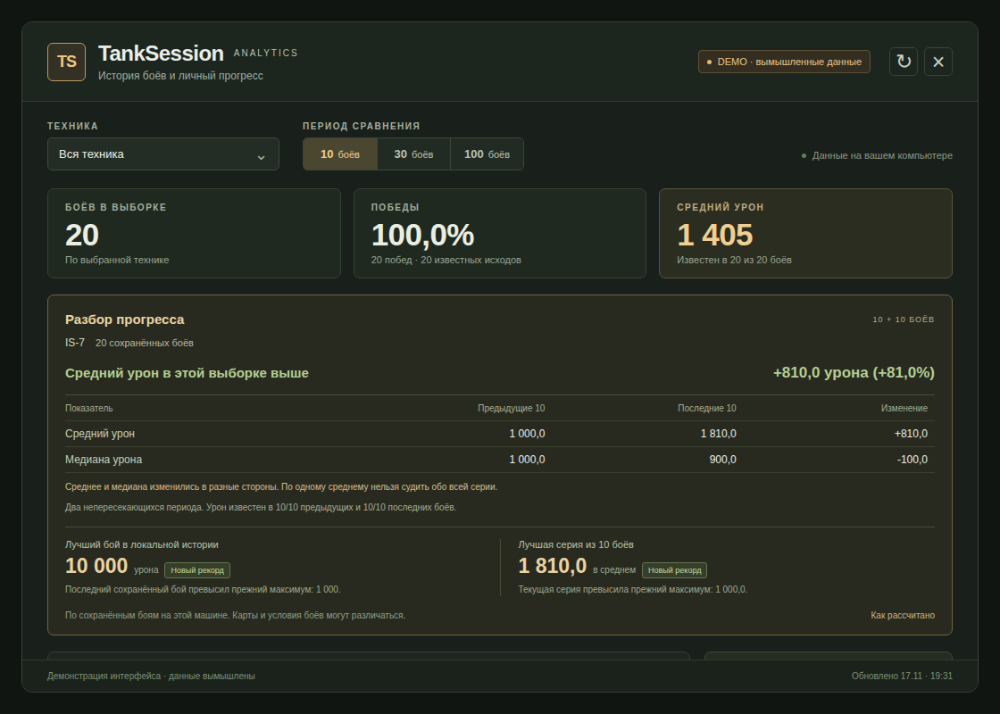

# TankSession Analytics — аналитика боёв для «Мира танков»

**Версия 0.4.0-rc7 · неофициальный проект · открытый исходный код (MIT)**


TankSession Analytics сохраняет собственные послебоевые результаты и показывает, как меняется урон на выбранной машине: сравнивает два периода, объясняет разницу между средним и медианой, отмечает рекорды локальной истории и прогресс целей. Интерфейс написан на **React и TypeScript**, расчёты и хранение — на Python. Доступны браузерный просмотр и экспериментальное окно **Gameface в ангаре**.

> **Статус: кандидат для испытаний.** На клиенте **1.46.0.0** подтверждено сохранение реального боя в rc4, а в rc5 — открытие нативного Gameface, фильтры и отображение новых результатов. В rc6 подтверждён доступ ко всем вкладкам без прокрутки. Rc7 предлагает исправления положения и фона окна; они ещё требуют игровой проверки. Подробности — в [протоколе](docs/CLIENT_VALIDATION_RU.md). Проект не связан с Lesta Games.



*Разбор прогресса rc5 на специальном примере из 20 вымышленных боёв: среднее выросло, медиана снизилась. Снимок получен в Chromium, 1120 × 800, в [CI коммита d54fd5e](https://github.com/xeemoff/tanksession-analytics/actions/runs/44936121011). Это не снимок игрового клиента; обычное демо содержит 48 боёв.*

## Что изменилось в rc7

Необязательное центрирование нативного окна после первого запроса, стабильная высота панели, прозрачный фон вне неё, уточнение вёрстки графика и целей. Отказ центрирования не блокирует окно. Совместимость в игре ещё предстоит подтвердить.

## Что изменилось в rc6

Вкладки «Прогресс», «Динамика и цели», «История боёв», постраничные списки, текстовая кнопка обновления и уточнение контраста. Проверенный ключ `ussr:R04_T-34` отображается как «Т-34»; остальные неизвестные ключи сохранены без выдуманных названий. Доступ к трём вкладкам rc6 подтверждён; пагинация большой истории ещё не проверена.

## Что изменилось в rc5

- **Разбор прогресса (Session Coach):** последние 10, 30 или 100 боёв на одной машине сравниваются с таким же предыдущим периодом. Среднее и медиана показаны рядом, с размерами выборок и объяснением расчёта.
- **Честная нехватка данных:** один бой задаёт исходную точку. Для первого сравнения 10 + 10 нужны ещё 19; неизвестный урон не считается нулём. При разных известных типах боёв сравнение скрывается.
- **Личные рекорды:** лучший урон за бой и лучшее полное скользящее окно в сохранённой истории. Равенство максимуму и первая запись не объявляются новым рекордом.
- **Исправление сбора реальных результатов:** поддержаны доступные источники ID аккаунта и дополнительные варианты структуры собственной записи; на клиенте 1.46.0.0 подтверждено сохранение одного боя.
- **Настройки Windows:** UTF-8 с BOM принимается в settings.json и goals.json; остальные проверки типов и размеров сохранены.
- **Наглядное демо:** 48 вымышленных боёв, из них 24 на IS-7. Выбери IS-7 и окно 10, чтобы увидеть готовое сравнение.

Правила и ограничения разбора: [SESSION_COACH_RU.md](docs/SESSION_COACH_RU.md). Выводы описывают сохранённые результаты; они не устанавливают причину изменения или уровень навыка.

## Интерфейс и интеграция

- **Новый экран:** фильтр техники, окна 10/30/100 боёв, основные показатели, график с пропусками неизвестных значений, сравнение периодов, цели и 12 последних боёв.
- **Связь Python → интерфейс:** один проверяемый JSON-контракт. Интерфейс не передаёт ID аккаунта; данные выбираются по подтверждённому контексту Python.
- **Экспериментальное окно ангара:** F8, закрытие через Esc, отдельный opt-in, снятие подписок и уничтожение окна при смене контекста. Требуется внешний загрузчик OpenWG Gameface; открытие и фильтры проверены в rc5; rc6 проверен в части вкладок; rc7 требует испытания.
- **Явные состояния:** демо, локальная история, игровой источник, пустые данные и ошибка подключения. При сбое старые показатели очищаются.
- **Готовый браузерный просмотр:** CI упаковывает собранный интерфейс с локальным сервером. Для запуска этого архива нужны Python 3.9+ и браузер; Node.js нужен только при сборке из исходников.
- **Проверки интерфейса:** TypeScript, тесты транспорта и совместимости с Python, браузерные сценарии Playwright; лицензии зависимостей входят в пакет.

Дополнение неполных результатов, разделение аккаунтов, диагностика журнала и воспроизводимая сборка из rc3 сохранены.

## Возможности аналитики

История включает исход, технику, урон, помощь союзникам и опыт, если эти показатели известны. Доступны фильтры по аккаунту, танку и датам, сравнение двух непересекающихся окон по 10/30/100 боёв, скользящий средний урон, сводка по технике и CSV с текущими фильтрами.

Пропуски остаются неизвестными значениями. Процент побед считается по известным исходам; средний урон — по известным значениям. График скользящего среднего требует не менее 70% известных значений в полном окне. Усреднение после сортировки линейное; сортировка всей истории остаётся `O(n log n)`.

Браузерные панели работают на `127.0.0.1`. Python-часть использует стандартную библиотеку, React включён в локальную сборку интерфейса. Внешнего сервера, телеметрии и C++ в проекте нет. В новом окне пока нет выбора дат, переключения аккаунтов и CSV: эти функции доступны в прежней панели.

## Новый интерфейс: быстрый просмотр

В [GitHub Actions](https://github.com/xeemoff/tanksession-analytics/actions/workflows/tests.yml) открой успешный запуск нужного коммита и artifact **`tanksession-hangar-preview-...`**. Распакуй находящийся в нём `TankSession_Analytics_0.4.0-rc7_Preview.zip`, затем запусти **`demo_hangar.cmd`** или:

```powershell
python tools/preview_ui.py --demo
```

Откроются 48 вымышленных боёв. Это просмотр React-интерфейса в браузере: он не запускает Gameface и не устанавливает мод. Артефакты хранятся 14 дней; их можно заново собрать из исходников.

Если скачан исходный код, сначала нужны Node.js 20+ и сборка ресурсов:

```powershell
cd ui
npm ci
npm run build
cd ..
python tools/preview_ui.py --demo
```

Для собственной истории укажи файл и ID своего аккаунта; несколько аккаунтов не объединяются:

```powershell
python tools/preview_ui.py --data "D:\your-folder\battles.jsonl" --account "ID_АККАУНТА"
```

Адрес по умолчанию — **http://127.0.0.1:8770/**. `--port 0` выбирает свободный порт, `--no-browser` отключает автоматическое открытие. Остановка — `Ctrl+C`.

Для установки экспериментального окна в ангар см. [Gameface: зависимости, включение и проверка](docs/GAMEFACE_RU.md). Включение выполняется отдельно через `experimental_gameface_ui`; по умолчанию оно выключено.

## Прежняя панель и CSV на Windows

Нужны **Python 3.9+** и браузер. Дополнительные Python-пакеты для работы панели не требуются.

- Для демонстрации дважды нажми **`demo_dashboard.cmd`**: откроются 48 вымышленных боёв и пример целей.
- Для своей истории запусти **`start_dashboard.cmd`** и выбери папку игры с `paths.xml`. Диалог требует стандартный Tkinter; если он недоступен, используй команды ниже.
- Если мод ещё не записал первый результат, панель покажет ожидание журнала. Нажми обновление страницы после появления данных.
- Для остановки сервера нажми `Ctrl+C` в его консольном окне.

```powershell
python tools/launch_dashboard.py --demo
python tools/launch_dashboard.py --game-dir "D:\Games\Tanki"
python tools/launch_dashboard.py --data "D:\your-folder\battles.jsonl"
```

Если порт занят, добавь `--port 0`: программа выберет свободный и покажет адрес. `--no-browser` оставляет ручное открытие адреса. Для Linux доступны те же Python-команды.

Прежний способ запуска сохранён:

```powershell
python tools/dashboard.py --goals sample_data/goals.json
```

Адрес по умолчанию — **http://127.0.0.1:8765/**. Путь по выбранной папке: `mods/configs/tanksession_analytics/battles.jsonl`. Фактический путь игрового адаптера нужно сверить со строкой `[TankSession] Started; local data path:` в `python.log`.

## Персональные цели

Пример из [sample_data/goals.json](sample_data/goals.json):

```json
[
  {"account_id": "demo", "vehicle": "IS-7", "target_avg_damage": 2700, "window": 10}
]
```

`vehicle` должен точно совпадать с названием в истории. Достоверный стабильный ID техники ещё предстоит подтвердить в клиенте. Указанный `account_id` привязывает цель к аккаунту. Если поле отсутствует, цель применяется отдельно к каждому видимому аккаунту; записи разных аккаунтов никогда не объединяются для достижения цели.

```powershell
python tools/launch_dashboard.py --data "D:\your-folder\battles.jsonl" --goals "D:\your-folder\goals.json"
```

Учитываются текущие фильтры панели. Достижение требует полного окна и известного урона минимум в 70% боёв. Решение принимается до округления среднего; рядом показано число известных значений.

## Надёжность истории

Ключ боя — `(account_id, arena_id)`. Повторный результат может заполнить только отсутствующие поля. Если уже известные показатели противоречат друг другу, новая ревизия отклоняется целиком, а конфликт отмечается в диагностике.

`data_status=complete` означает, что известны **исход, урон и опыт**; нулевые значения допустимы. Это не гарантия наличия всех полей клиента. До получения основных показателей ожидание результата остаётся в отдельном журнале. Полезная ревизия записывается через `write → flush → fsync`; затем обновляется память.

Читатель поддерживает schema 1 и старые записи без явно указанной схемы. Числовые поля ограничены диапазоном `0..2**63-1`; недопустимые типы и версии схемы отклоняются. `timestamp` сохраняет **первое время получения результата**, а не точное время начала боя. Повторное событие не переносит бой на новую дату.

Для проверки истории:

```powershell
python tools/maintain_data.py --data "D:\your-folder\battles.jsonl"
```

Для компактирования **закрой игру и панель**:

```powershell
python tools/maintain_data.py --data "D:\your-folder\battles.jsonl" --compact
```

Команда сохраняет точную резервную копию исходного файла и заменяет журнал последними допустимыми снимками боёв. Проверки изменения файла снижают риск, но не заменяют межпроцессную блокировку. Только один процесс должен записывать историю. Старые версии панели не умеют объединять ревизии rc3; для чтения обновлённой истории используй rc3 или новее.

## Проверки и сборка

```powershell
python -m compileall -q src tools tests
python -m unittest discover -s tests -v
python tools/simulate_capture.py
python tools/generate_ui_fixtures.py --check
python tools/benchmark.py --battles 100000
cd ui
npm ci
npm run typecheck
npm test
npm run build
npx playwright install chromium
npm run test:browser
cd ..
```

[GitHub Actions](https://github.com/xeemoff/tanksession-analytics/actions/workflows/tests.yml) запускает тесты Python 3.9/3.12 на Ubuntu и Python 3.12 на Windows. В набор входят реальные loopback HTTP-запросы, CSV, испорченная история, дополнения, аккаунты и имитация жизненного цикла клиента.

Job **React / TypeScript / browser preview** проверяет транспорт, общие JSON-примеры, настоящую страницу в Chromium и сохраняет снимок браузерного демо. Это проверка браузера, а не встроенного движка Gameface.

Отдельный job **CPython 2.7 / reproducible mtmod** собирает официальный интерпретатор из исходников с закреплённым SHA-256. В нём выполняются шесть runtime-сценариев, настоящая компиляция и сравнение двух независимых сборок. В обычной Python 3 среде два теста, требующие `PYTHON2`, явно пропускаются; это не равнозначно проверке Python 2.7.

После успешного job для нужного коммита доступен artifact `tanksession-mtmod-candidate-...` с пакетом и контрольной суммой. Артефакт хранится 14 дней и предназначен для проверки; автоматическая установка и публичный игровой релиз не выполняются.

Локальная сборка требует предварительно собранного `ui/dist` и отдельного CPython 2.7:

```powershell
python tools/build.py --python2 "C:\Python27\python.exe"
python tools/build.py --verify "dist\ru.tanksession.analytics_0.4.0-rc7.mtmod"
```

`--verify` проверяет состав 12 модулей, пять ресурсов интерфейса/регистрации, метаданные, CRC и заголовки байткода. Он не исполняет архив и не доказывает его поведение. Проверка собственных свежескомпилированных code objects выполняется при сборке. Подробности: [архитектура и инженерные решения](docs/ARCHITECTURE_RU.md).

## Проверка в игре и ограничения

Загрузка `.mtmod`, события, структура результатов, версия интерпретатора и соответствие действующим правилам игры требуют проверки в установленном клиенте. Начни с [пошагового тест-плана](docs/CHECK_CLIENT_RU.md); результаты запиши в [протокол совместимости](docs/CLIENT_VALIDATION_RU.md).

Экспериментальный доступ к `battleResultsCache` **выключен по умолчанию**. Отсутствующие результаты нельзя достоверно восстановить, если клиент их не предоставил. Не включай восстановление до проверки API своей версии игры.

Мод предназначен для собственной послебоевой истории. Не публикуй реальные журналы, настройки и ID аккаунтов. Для обсуждения проблем есть команда, выводящая только агрегированные счётчики:

```powershell
python tools/diagnose_log.py --log "D:\your-folder\python.log" --json
```

## Материалы

- [Быстрый старт](START_HERE_RU.md)
- [Окно Gameface: подключение и ограничения](docs/GAMEFACE_RU.md)
- [Архитектура и инженерные решения](docs/ARCHITECTURE_RU.md)
- [Проверка клиента](docs/CHECK_CLIENT_RU.md) и [протокол](docs/CLIENT_VALIDATION_RU.md)
- [Подробности интеграции](docs/integration.md)
- [История изменений](CHANGELOG.md) и [план развития](docs/roadmap.md)
- [Правила публикации](docs/PUBLICATION_RU.md)
- [Лицензия MIT](LICENSE)
