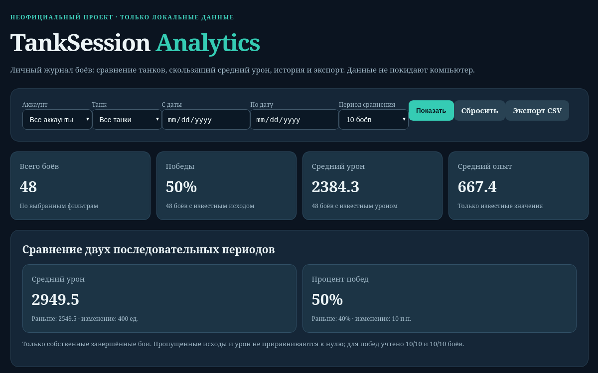

# TankSession Analytics — аналитика боёв для «Мира танков»

**Версия 0.4.0-rc3 · неофициальный проект · открытый исходный код (MIT)**


TankSession Analytics сохраняет результаты собственных боёв в локальный журнал и показывает статистику в браузере: сравнение периодов, динамику урона, цели по технике и экспорт CSV. Проект написан на Python без сторонних библиотек времени выполнения.

> **Статус: кандидат для разработчиков.** Реальные события, поля результатов и загрузка мода в актуальном клиенте Lesta ещё не подтверждены. Автотесты, выполнение чистых модулей на CPython 2.7 и сборка пакета проверяются отдельно. Успешная сборка `.mtmod` не означает совместимость с игрой. Проект не связан с Lesta Games.



*Снимок демонстрационной панели версии 0.3. В rc3 добавлены состояние журнала и отдельные цели для аккаунтов. Синтетические данные не подтверждают работу в клиенте.*

## Что изменилось в rc3

- **Дополнение результата:** неполный результат можно дополнить после повторного события или перезапуска. В статистике остаётся один бой; журнал хранит полезные ревизии.
- **Разделение аккаунтов:** цели и уведомление ангара относятся к конкретному аккаунту. Пять боёв одного аккаунта и пять другого не засчитывают одну цель на десять боёв.
- **Проверка истории:** неверные типы, неизвестные схемы и повреждённые строки пропускаются с отдельными счётчиками. Исходный файл при чтении не меняется.
- **Понятное состояние панели:** демоданные, отсутствие журнала, ошибка доступа, время последнего результата, неполные записи и конфликты.
- **Удобный запуск:** выбор папки игры и открытие браузера через `start_dashboard.cmd`; отдельный запуск демо через `demo_dashboard.cmd`.
- **Восстановление:** лимит учитывает неудачные попытки; устаревшие ответы и таймеры предыдущего входа игнорируются.
- **Проверяемая сборка:** отдельный CI job собирает официальный CPython 2.7.18, выполняет проверки, сравнивает две сборки и сохраняет `.mtmod` с SHA-256.

## Возможности аналитики

История включает исход, технику, урон, помощь союзникам и опыт, если эти показатели известны. Доступны фильтры по аккаунту, танку и датам, сравнение двух непересекающихся окон по 10/30/100 боёв, скользящий средний урон, сводка по технике и CSV с текущими фильтрами.

Пропуски остаются неизвестными значениями. Процент побед считается по известным исходам; средний урон — по известным значениям. График скользящего среднего требует не менее 70% известных значений в полном окне. Усреднение после сортировки линейное; сортировка всей истории остаётся `O(n log n)`.

Панель работает отдельно от игры на `127.0.0.1`. React, Gameface, внешний сервер, телеметрия и C++ в текущем проекте не используются.

## Быстрый запуск на Windows

Нужны **Python 3.9+** и браузер. Дополнительные Python-пакеты для работы панели не требуются.

- Для демонстрации дважды нажми **`demo_dashboard.cmd`**: откроются 48 вымышленных боёв и пример целей.
- Для своей истории запусти **`start_dashboard.cmd`** и выбери папку игры с `paths.xml`. Диалог требует стандартный Tkinter; если он недоступен, используй команды ниже.
- Если мод ещё не записал первый результат, панель покажет ожидание журнала. Нажми обновление страницы после появления данных.
- Для остановки сервера нажми `Ctrl+C` в его консольном окне.

```powershell
python tools/launch_dashboard.py --demo
python tools/launch_dashboard.py --game-dir "D:\Games\Tanki"
python tools/launch_dashboard.py --data "D:\your-folder\battles.jsonl"
```

Если порт занят, добавь `--port 0`: программа выберет свободный и покажет адрес. `--no-browser` оставляет ручное открытие адреса. Для Linux доступны те же Python-команды.

Прежний способ запуска сохранён:

```powershell
python tools/dashboard.py --goals sample_data/goals.json
```

Адрес по умолчанию — **http://127.0.0.1:8765/**. Путь по выбранной папке: `mods/configs/tanksession_analytics/battles.jsonl`. Фактический путь игрового адаптера нужно сверить со строкой `[TankSession] Started; local data path:` в `python.log`.

## Персональные цели

Пример из [sample_data/goals.json](sample_data/goals.json):

```json
[
  {"account_id": "demo", "vehicle": "IS-7", "target_avg_damage": 2700, "window": 10}
]
```

`vehicle` должен точно совпадать с названием в истории. Достоверный стабильный ID техники ещё предстоит подтвердить в клиенте. Указанный `account_id` привязывает цель к аккаунту. Если поле отсутствует, цель применяется отдельно к каждому видимому аккаунту; записи разных аккаунтов никогда не объединяются для достижения цели.

```powershell
python tools/launch_dashboard.py --data "D:\your-folder\battles.jsonl" --goals "D:\your-folder\goals.json"
```

Учитываются текущие фильтры панели. Достижение требует полного окна и известного урона минимум в 70% боёв. Решение принимается до округления среднего; рядом показано число известных значений.

## Надёжность истории

Ключ боя — `(account_id, arena_id)`. Повторный результат может заполнить только отсутствующие поля. Если уже известные показатели противоречат друг другу, новая ревизия отклоняется целиком, а конфликт отмечается в диагностике.

`data_status=complete` означает, что известны **исход, урон и опыт**; нулевые значения допустимы. Это не гарантия наличия всех полей клиента. До получения основных показателей ожидание результата остаётся в отдельном журнале. Полезная ревизия записывается через `write → flush → fsync`; затем обновляется память.

Читатель поддерживает schema 1 и старые записи без явно указанной схемы. Числовые поля ограничены диапазоном `0..2**63-1`; недопустимые типы и версии схемы отклоняются. `timestamp` сохраняет **первое время получения результата**, а не точное время начала боя. Повторное событие не переносит бой на новую дату.

Для проверки истории:

```powershell
python tools/maintain_data.py --data "D:\your-folder\battles.jsonl"
```

Для компактирования **закрой игру и панель**:

```powershell
python tools/maintain_data.py --data "D:\your-folder\battles.jsonl" --compact
```

Команда сохраняет точную резервную копию исходного файла и заменяет журнал последними допустимыми снимками боёв. Проверки изменения файла снижают риск, но не заменяют межпроцессную блокировку. Только один процесс должен записывать историю. Старые версии панели не умеют объединять ревизии rc3; для чтения обновлённой истории используй rc3 или новее.

## Проверки и сборка

```powershell
python -m compileall -q src tools tests
python -m unittest discover -s tests -v
python tools/simulate_capture.py
python tools/benchmark.py --battles 100000
```

[GitHub Actions](https://github.com/xeemoff/tanksession-analytics/actions/workflows/tests.yml) запускает тесты Python 3.9/3.12 на Ubuntu и Python 3.12 на Windows. В набор входят реальные loopback HTTP-запросы, CSV, испорченная история, дополнения, аккаунты и имитация жизненного цикла клиента.

Отдельный job **CPython 2.7 / reproducible mtmod** собирает официальный интерпретатор из исходников с закреплённым SHA-256. В нём выполняются пять runtime-сценариев, настоящая компиляция и сравнение двух независимых сборок. В обычной Python 3 среде два теста, требующие `PYTHON2`, явно пропускаются; это не равнозначно проверке Python 2.7.

После успешного job для нужного коммита доступен artifact `tanksession-mtmod-candidate-...` с пакетом и контрольной суммой. Артефакт хранится 14 дней и предназначен для проверки; автоматическая установка и публичный игровой релиз не выполняются.

Локальная сборка с отдельным CPython 2.7:

```powershell
python tools/build.py --python2 "C:\Python27\python.exe"
python tools/build.py --verify "dist\ru.tanksession.analytics_0.4.0-rc3.mtmod"
```

`--verify` проверяет состав девяти модулей, метаданные, CRC и заголовки байткода. Он не исполняет архив и не доказывает его поведение. Проверка собственных свежескомпилированных code objects выполняется при сборке. Подробности: [архитектура и инженерные решения](docs/ARCHITECTURE_RU.md).

## Проверка в игре и ограничения

Загрузка `.mtmod`, события, структура результатов, версия интерпретатора и соответствие действующим правилам игры требуют проверки в установленном клиенте. Начни с [пошагового тест-плана](docs/CHECK_CLIENT_RU.md); результаты запиши в [протокол совместимости](docs/CLIENT_VALIDATION_RU.md).

Экспериментальный доступ к `battleResultsCache` **выключен по умолчанию**. Отсутствующие результаты нельзя достоверно восстановить, если клиент их не предоставил. Не включай восстановление до проверки API своей версии игры.

Мод предназначен для собственной послебоевой истории. Не публикуй реальные журналы, настройки и ID аккаунтов. Для обсуждения проблем есть команда, выводящая только агрегированные счётчики:

```powershell
python tools/diagnose_log.py --log "D:\your-folder\python.log" --json
```

## Материалы

- [Быстрый старт](START_HERE_RU.md)
- [Архитектура и кейсы для собеседования](docs/ARCHITECTURE_RU.md)
- [Проверка клиента](docs/CHECK_CLIENT_RU.md) и [протокол](docs/CLIENT_VALIDATION_RU.md)
- [Подробности интеграции](docs/integration.md)
- [История изменений](CHANGELOG.md) и [план развития](docs/roadmap.md)
- [Правила публикации](docs/PUBLICATION_RU.md)
- [Лицензия MIT](LICENSE)
