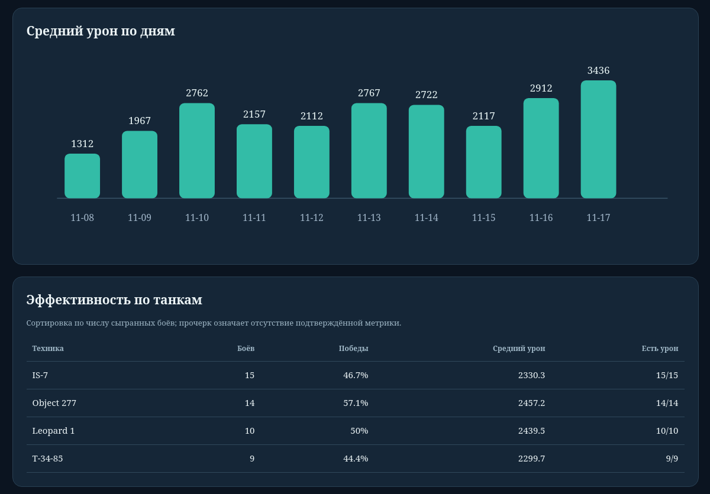

# TankSession Analytics


> **v0.4.0-rc1:** усилена проверка аккаунта, добавлены инструменты валидации `.mtmod` и обезличенной диагностики `python.log`. [Тест-план на русском](docs/CHECK_CLIENT_RU.md). Поддержка актуального клиента игры пока **не подтверждена**.

TankSession Analytics — неофициальный проект для анализа собственных боёв в «Мире танков». В локальной панели можно сравнить две серии боёв, проследить динамику урона и посмотреть результаты по каждому танку.

**Статус v0.4.0-rc1 — предварительная версия.** Панель можно запустить без игры на 48 вымышленных боях. Игровой адаптер проверен на имитации событий. Запись результатов из актуального клиента «Мира танков» ещё предстоит проверить.


*На снимке показаны 48 вымышленных боёв. Средний урон за последние десять вырос с 2549,5 до 2949,5.*

## Быстрый запуск

Понадобятся Python 3.9 или новее и браузер. Все зависимости входят в стандартную библиотеку Python. Выполните команду из корня проекта.

```sh
python tools/dashboard.py
```

Откройте [локальную панель](http://127.0.0.1:8765/). Если в Linux интерпретатор запускается командой `python3`, используйте её вместо `python`. Для остановки сервера нажмите `Ctrl+C`.

Для первого знакомства оставьте окно **10 боёв**. Панель сравнит последние десять результатов с предыдущими десятью. Выберите танк и нажмите **«Показать»**. Сводка и таблицы пересчитаются, а **«Экспорт CSV»** выгрузит выбранные бои. Для окон по 30 и 100 боёв понадобятся как минимум 60 и 200 записей соответственно.

Свой журнал можно открыть параметром `--data`.

```sh
python tools/dashboard.py --data "путь/к/battles.jsonl"
```

## Что показывает панель

| Возможность | Как читать результат |
| --- | --- |
| Сравнение периодов | Два последовательных окна по 10, 30 или 100 боёв. Изменение среднего урона показано в единицах урона, доли побед — в процентных пунктах. |
| Динамика урона | График по дням и скользящее среднее по боям. Точка скользящего среднего появляется, когда урон известен хотя бы для 70% боёв в окне. |
| Статистика по технике | Для каждого танка видны число боёв, доля побед, средний урон и число боёв с известным уроном. |
| История и экспорт | Фильтры по аккаунту, танку и датам действуют одновременно. На странице видны последние 150 боёв выборки, в CSV попадает вся выборка. Кодировка UTF-8 с BOM подходит для открытия в Excel. |



Даты на графиках соответствуют моменту получения результата и отображаются в часовом поясе компьютера. Неизвестный урон исключается из среднего, а неизвестный исход — из расчёта доли побед.

## Архитектура и технологии

Игровой адаптер и браузерная панель работают раздельно. Их связывает журнал в формате JSONL. Каждая строка содержит результат одного боя. Это позволяет воспроизводить обработку событий в тестах и исследовать журнал без запуска игрового клиента.

| Компонент | Ответственность |
| --- | --- |
| [Точка входа и игровой адаптер](src/res/scripts/client/gui/mods/) | Загружают мод, подключают обработчики событий и снимают подписки при выгрузке. Клиентская часть написана с расчётом на Python 2.7. |
| [Обработка результата](src/res/scripts/client/gui/mods/tanksession_analytics/recorder.py) и [нормализация](src/res/scripts/client/gui/mods/tanksession_analytics/core.py) | Сопоставляют результат с контекстом боя, извлекают показатели игрока и передают запись на сохранение. |
| [Хранилище](src/res/scripts/client/gui/mods/tanksession_analytics/storage.py) и [восстановление](src/res/scripts/client/gui/mods/tanksession_analytics/recovery.py) | Предотвращают повторную запись результата и сохраняют контекст незавершённых боёв. Обращение к игровому кэшу для получения пропущенного результата экспериментально и по умолчанию выключено. |
| [Аналитика](src/res/scripts/client/gui/mods/tanksession_analytics/analytics.py) | Упорядочивает записи, применяет фильтры и вычисляет показатели по технике и временным окнам. |
| [Веб-панель](tools/dashboard.py) | Читает журнал на Python 3, обслуживает HTTP на локальном адресе, формирует HTML-страницу с графиками SVG и отдаёт CSV. |

Хранилище рассчитано на один процесс записи. После добавления строки оно вызывает `flush` и `fsync`. При повторном чтении журнал пропускает повреждённые строки и дубликаты. В репозитории хранится только [синтетический пример](sample_data/battles.jsonl), который можно воспроизвести [генератором](tools/generate_demo.py).

## Проверка

```sh
python -m unittest discover -s tests -v
python tools/simulate_capture.py
```

В версии 0.4.0-rc1 — 60 автотестов. Они покрывают расчёты с неполными данными, повторную доставку результата, чтение журнала после сбоя, игровой адаптер на имитации и экспорт CSV. Симуляция воспроизводит досрочный выход из боя. Получив результат из имитации кэша, обработчик сохраняет бой и снимает его с учёта в журнале ожидания. [Сценарий GitHub Actions](.github/workflows/tests.yml) запускает тесты на Python 3.9 и 3.12.

## Проверка в игровом клиенте

Релиз содержит исходники. Для пробной сборки `.mtmod` понадобится отдельный интерпретатор Python 2.7. В Windows команда сборки с примером пути выглядит так.

```powershell
python tools/build.py --python2 "C:\Python27\python.exe"
```

Скрипт записывает пакет в `dist/ru.tanksession.analytics_0.4.0-rc1.mtmod`. Установку, получение событий боя и совпадение полей с послебоевым экраном нужно проверить на конкретной версии игры. Этапы проверки описаны в [плане испытаний](docs/integration.md).

[История изменений](CHANGELOG.md) · [План развития](docs/roadmap.md) · [Лицензия MIT](LICENSE)

## Новые инструменты v0.4.0-rc1

```powershell
python tools/build.py --python2 "C:\\Python27\\python.exe"
python tools/build.py --verify "dist\\ru.tanksession.analytics_0.4.0-rc1.mtmod"
python tools/diagnose_log.py --log "C:\\путь\\к\\python.log" --json
```

`--verify` проверяет содержимое архива, **но не подтверждает работу игры**. Диагностика сообщает только агрегированные счётчики, не публикуя содержимое лога. Проверять на своём клиенте следует по [инструкции](docs/CHECK_CLIENT_RU.md).
