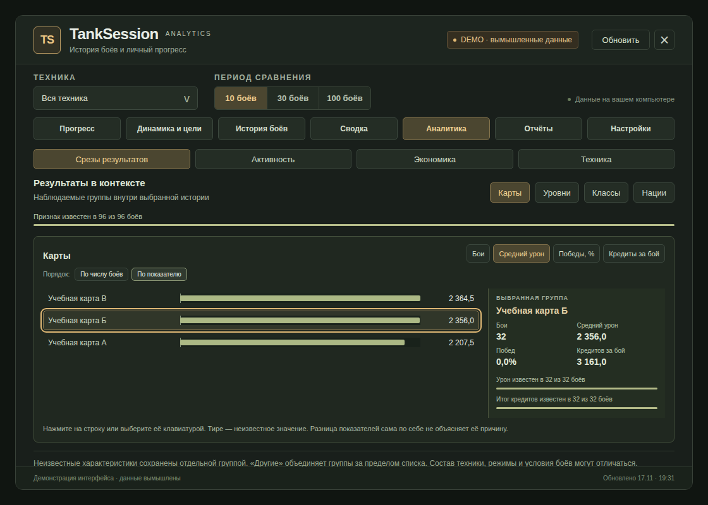
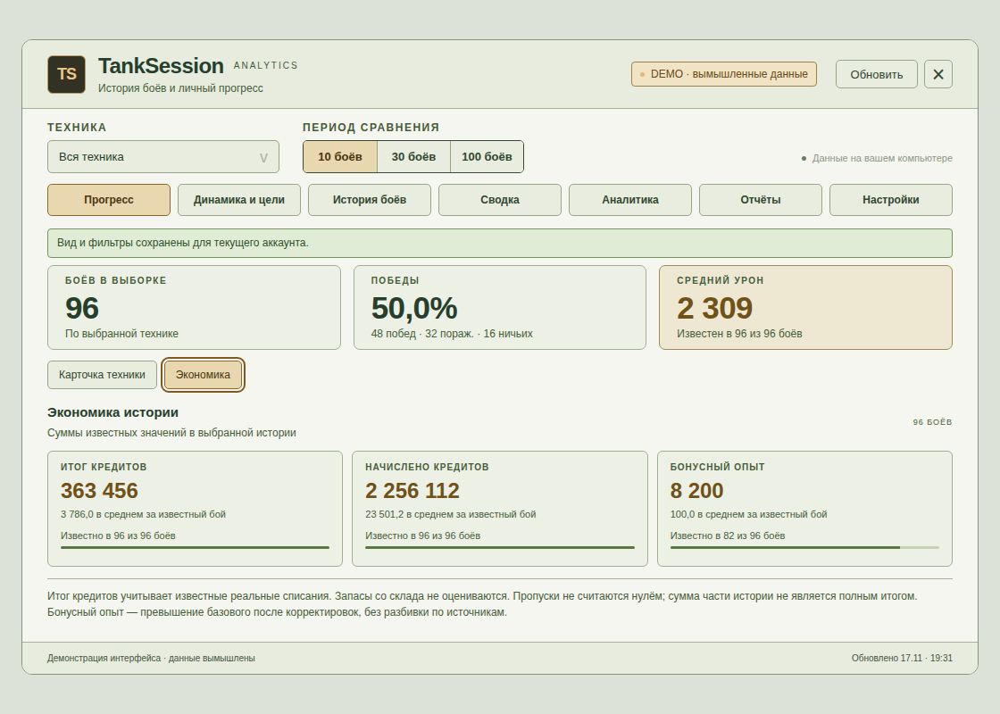

# TankSession Analytics

**Персональная аналитика завершённых боёв для «Мира танков».**


TankSession Analytics собирает собственные послебоевые результаты и показывает динамику урона, карты и технику, активность, экономику, цели и отчёты за период. Интерфейс на **React + TypeScript** доступен в ангаре через **Gameface** и отдельно в браузере. Самостоятельный **C++23-движок** строит офлайн-отчёты по той же проверенной истории. Данные обрабатываются и хранятся локально; внешние серверы проекта не используются.

[Быстрый старт](START_HERE_RU.md) · [Установка](docs/INSTALL_RU.md) · [Изменения 2.0](docs/releases/v2.0.0-rc2.md) · [Архитектура](docs/ARCHITECTURE_RU.md) · [Готовность 2.0](docs/READINESS_2_0_0_RU.md) · [Протокол испытаний](docs/CLIENT_VALIDATION_RU.md)

> **2.0.0-rc2 — исправления по игровой проверке RC1 на клиенте 1.46.0.0.** В RC1 подтверждены запуск менеджера и Gameface, сохранность прежней истории и добавление нового боя с картой и метаданными. Найдены ошибки сохранения настроек, колеса мыши, вёрстки и обновления дополнительного опыта. Их исправления требуют повторной проверки RC2 в игре; стабильный 2.0.0 ещё не принят. [Фактический протокол](docs/CLIENT_VALIDATION_RU.md). Проект самостоятельный и неофициальный.

## Возможности

| Раздел | Что доступно |
|---|---|
| **Прогресс** | Число записанных боёв, доля побед среди известных исходов, средний урон, среднее и медиана двух полных периодов 10 / 30 / 100 на одной машине, локальные рекорды |
| **Динамика и цели** | Урон каждого из 24 последних боёв, сведения по нажатию на столбец, скользящее среднее, прогресс целей по среднему урону |
| **История** | Вся загруженная история с серверной пагинацией по пять боёв, исходы, урон, опыт и подробности выбранного результата |
| **Аналитика 2.0** | Карты, классы, уровни и нации, календарь, часы/дни, экономика техники и покрытие известных значений |
| **Отчёты и Coach** | Неделя, месяц, вся история; разброс результатов, проверяемые наблюдения и предложение цели с явным принятием |
| **Сводка** | Исходы, серии, помощь, таблицы по дням и технике; дополнительные метрики с числом известных значений; карты и сессии |
| **Настройки** | Сохранение техники, окна сравнения, стартовой вкладки, плотности и контраста для текущего аккаунта; создание, изменение и удаление целей; экспорт CSV |
| **Персональный вид** | Темы, выбор блоков панели, поиск и сортировка истории, интерактивные диаграммы и режим уменьшенного движения |
| **Менеджер Windows** | Поиск игры, установка, удаление, возврат пакета, проверка выпусков и проверенные снимки истории |
| **C++ companion** | Групповые показатели, покрытие, дисперсия, медиана и p90; Python-адаптер, CLI, JSON, тесты совпадения и бенчмарки |
| **Качество данных** | Известный ноль отличается от неизвестного значения; видны неполные записи, конфликты и незакрытые ожидания текущего аккаунта |

Фильтр техники действует на аналитику и экспорт. Счётчик ожиданий относится ко всему аккаунту: ожидание может содержать уже записанный неполный результат и не означает окончательно потерянный бой. История не заменяет неизвестные поля нулями.

### Техника и совместимость прежней истории

Идентичность машины отделена от её подписи начиная с 1.0 RC2. Подтверждённый тип получает ключ `type:<дескриптор>`, точное внутреннее имя — запасной `name:<нация:имя>`. Фильтры, цели и экспорт используют этот ключ, а интерфейс показывает понятную подпись. При одинаковом подтверждённом ключе смена подписи не создаёт другую машину.

Старый журнал читается без перезаписи. Внутренние имена распознаются точно; прежняя подпись связывается с ключом только по однозначным данным того же аккаунта. Похожие названия не объединяются. При противоречивых ключах старая история остаётся отдельной группой, а сравнение, требующее одной подтверждённой машины, блокируется с пояснением. Правила описаны в [контракте данных](docs/DATA_AND_UI_RU.md).

### Сравнения, которые можно проверить

[Session Coach](docs/SESSION_COACH_RU.md) сравнивает две полные непересекающиеся выборки на одной машине, показывает среднее, медиану и размер выборки. Сессии — отдельные группы результатов с паузой **от 60 минут** между получениями. Для сравнения двух сессий нужны как минимум **10 боёв в каждой**, одна известная машина, один известный режим и известный урон во всех боях. При нехватке данных интерфейс объясняет причину.

Время записи означает первое получение результата модом, поэтому сессия не является точным замером игрового времени. Изменение среднего или медианы описывает сохранённые бои; оно само по себе не объясняет изменение навыка или причины результата.

### Дополнительные метрики

Поддержаны карта, уничтоженная техника, выживание, выстрелы, прямые попадания, пробития, базовый и бонусный опыт, начисленные и чистые кредиты. У каждого показателя есть объём доступных данных. Попадания и пробития рассчитываются по тем боям, где известна нужная пара счётчиков; отсутствие знаменателя не превращается в нулевой процент.

Ключ карты имеет вид `arena:<ID типа карты>`. В 2.0 подпись берётся из локализованного каталога клиента по точному ID, если объект доступен; старый ключ остаётся пригоден без подписи. Базовый опыт — известная неотрицательная разность `originalXP - achievementXP`. Бонусный опыт — полученный `personal.xp` сверх этой базовой строки; это итоговая разница после применённых корректировок, без разложения по отдельным бонусам.

Чистые кредиты рассчитываются по полной формуле поддержанного сценария: из начислений вычитаются два скорректированных удержания и фактические кредитные расходы на ремонт, снаряды и снаряжение, затем учитываются события наград. Расчёт доступен для режимов с кодами **1, 22 и 24**, одной машины и подтверждённого `personal.avatar`, только при наличии всех компонентов. Золото, боны, предметы со склада и будущая копилка в кредитный итог не включаются. Отсутствие любого компонента оставляет показатель неизвестным; отрицательный известный итог допустим.

Источником сопоставления служит закреплённая [справочная декомпиляция 1.46.0.0_CT](https://github.com/StranikS-Scan/WorldOfTanks-Decompiled/commit/e241d4d04d610f0747271ff6f044ee809a607b53). Она не подтверждает совпадение с установленной игрой. Формулы, ограничения и поля приведены в [DATA_AND_UI_RU.md](docs/DATA_AND_UI_RU.md); сверка с официальным экраном остаётся частью живых испытаний.

## Скачать и установить

**[Скачать 2.0.0-rc2](https://github.com/xeemoff/tanksession-analytics/releases/tag/v2.0.0-rc2)** — страница кандидата с готовыми архивами и контрольными суммами. Текущий статус автоматических проверок и испытаний в игре — в [отчёте готовности](docs/READINESS_2_0_0_RU.md).

| Файл | Назначение |
|---|---|
| [Windows.zip](https://github.com/xeemoff/tanksession-analytics/releases/download/v2.0.0-rc2/TankSession_Analytics_2.0.0-rc2_Windows.zip) | `.mtmod`, SHA-256, manifest, графический менеджер, инструкция и примечания. Для установки не нужны Python и Node.js |
| `ru.tanksession.analytics_2.0.0-rc2.mtmod` и `.sha256` | Пакет и контрольная сумма для ручной установки |
| [Preview.zip](https://github.com/xeemoff/tanksession-analytics/releases/download/v2.0.0-rc2/TankSession_Analytics_2.0.0-rc2_Preview.zip) | Браузерный просмотр с готовыми ресурсами. Нужны Python 3.9+ и браузер; Node.js не требуется |
| [Native Windows x64](https://github.com/xeemoff/tanksession-analytics/releases/download/v2.0.0-rc2/TankSession_Analytics_2.0.0-rc2_Native_Windows_x64.zip) / [Linux x64](https://github.com/xeemoff/tanksession-analytics/releases/download/v2.0.0-rc2/TankSession_Analytics_2.0.0-rc2_Native_Linux_x64.zip) | Отдельный C++-движок и Python 3-адаптер для отчётов; в игру не устанавливается |

В выпуске для каждого из пяти файлов есть отдельный `.sha256`. Промежуточные [артефакты Actions](https://github.com/xeemoff/tanksession-analytics/actions/workflows/tests.yml) хранятся 14 дней; для их скачивания может требоваться вход в GitHub. Полная инструкция — [INSTALL_RU.md](docs/INSTALL_RU.md).

1. **Закрой игру** и распакуй весь Windows-архив в обычную папку.
2. Запусти **manager.cmd**, найди или выбери папку игры, проверь версию клиента и нажми «Установить / обновить». Установщик проверит пакет, сохранит предыдущие пакеты TankSession и заменит их; при ошибке замены выполнит откат.

**Папку `mods/configs/tanksession_analytics/` сохраняй.** В ней находятся история, ожидания результатов и настройки. Установщик их не изменяет. Для Gameface требуется отдельно установленный совместимый OpenWG Gameface и включённая настройка `experimental_gameface_ui`. Окно и экспериментальное восстановление через кэш по умолчанию выключены. Подробности подключения — в [GAMEFACE_RU.md](docs/GAMEFACE_RU.md).

Менеджер 2.0 перед обновлением сохраняет снимок истории и настроек в `mods/tanksession_data_backups/`. Экспорт переносит весь локальный снимок; импорт заменяет перечисленные файлы после резервирования текущих данных. Это отдельная операция с явным подтверждением, а не автоматическое слияние журналов. Проверка обновлений обращается к GitHub только по кнопке и не отправляет историю.

## Зачем отдельный C++-движок

Игровой адаптер остаётся совместимым с Python 2.7. Внешний C++23-процесс получает от Python 3 только ограниченный числовой протокол после валидации журнала, отбора одного аккаунта и разрешения техники. Названия, ID аккаунта и ID боя не требуются нативному алгоритму. Адаптер связывает числовые группы с подписями уже при формировании локального отчёта.

Так можно независимо тестировать арифметику, парсер и ограничения памяти, измерять сам алгоритм и весь путь с запуском процесса, а также сравнивать результат с Python-реализацией. Ускорение не предполагается заранее: подготовка данных и запуск процесса тоже стоят времени. Команды сборки, запуска и измерений — [NATIVE_CORE_RU.md](docs/NATIVE_CORE_RU.md).

Для последовательного разбора исходников подготовлен [путеводитель по проекту и собеседованию](docs/INTERVIEW_GUIDE_RU.md). Он отделяет реализованные решения от игровых допущений и предлагает задачи, которые нужно уметь объяснить и выполнить самостоятельно.

## Браузерный просмотр

Распакуй Preview и запусти **demo_hangar.cmd** либо:

```powershell
python tools/preview_ui.py --demo
```

Данные демонстрации вымышленные и явно помечены. Выбери IS-7 и окно 10 для сравнения двух полных периодов. Можно открыть детали, проверить настройки, цели и экспорт. Изменения демонстрации записываются во временный профиль и не затрагивают игровую историю.

Если работаешь с исходниками, сначала собери ресурсы с Node.js 20+:

```powershell
cd ui
npm ci
npm run build
cd ..
python tools/preview_ui.py --demo
```

Собственная история по умолчанию открывается **только для чтения**:

```powershell
python tools/preview_ui.py --data "D:/your-folder/battles.jsonl" --account "ID_АККАУНТА"
```

Для локального сохранения профиля, редактирования целей и CSV добавь **`--allow-write`**. Профили и экспорт создаются рядом с выбранным журналом; сам журнал не перезаписывается. При совместном использовании той же папки с игровым модом сначала закрой игру. Сервер слушает только `127.0.0.1`, адрес по умолчанию — `http://127.0.0.1:8770/`. `--port 0` выбирает свободный порт, `--no-browser` оставляет ручное открытие. Остановка — Ctrl+C.

## Настройки, цели и CSV

В разделе настроек можно сохранить текущую технику, окно сравнения, стартовую вкладку, плотность и контраст. Выбор хранится для подтверждённого аккаунта. Личные настройки и цели находятся в `profiles/*.json`, предыдущая версия профиля сохраняется в `.bak`. Полностью записанный временный файл заменяет профиль через доступный атомарный API; в урезанном Windows Python без него используются переименования с копией `.rollback` и восстановлением после прерывания. Подробные гарантии — в [контракте данных](docs/DATA_AND_UI_RU.md).

Цель состоит из техники, размера окна и целевого среднего урона. Она считается достигнутой только при полном окне и **100% известных значений урона**; сравнение выполняется до округления. Цели разных аккаунтов не объединяются.

Старый `goals.json` продолжает читаться как источник целей, пока для аккаунта не сохранён собственный набор. Редактор не перезаписывает этот файл и историю. Для внешней панели прежний JSON-формат остаётся доступен:

```json
[
  {"account_id": "demo", "vehicle": "IS-7", "target_avg_damage": 2700, "window": 10}
]
```

Пример относится к вымышленному аккаунту и прежнему текстовому ключу. Редактор выбирает текущий ключ машины автоматически; старые ключи разрешаются только по точному однозначному соответствию в истории своего аккаунта. Без `account_id` шаблон применяется отдельно к каждому видимому аккаунту.

Команда CSV экспортирует **всю доступную историю выбранной техники текущего аккаунта**, а не только текущую страницу. При выборе всей техники экспортируется вся история аккаунта. Папка в игре — `mods/configs/tanksession_analytics/exports/`; в браузерном просмотре — `exports/` рядом с журналом. CSV содержит подпись и необязательный ключ типа техники, базовый и бонусный опыт, известные кредитные показатели; ID аккаунта и конкретного боя исключены. Текстовые ячейки защищены от интерпретации как формулы, кодировка — UTF-8 с BOM. Новый экспорт не заменяет предыдущий.

## Надёжность истории

Ключ боя — пара `(account_id, arena_id)`. Повторный результат может заполнить отсутствующие поля. Конфликт уже известных показателей отклоняется целиком и отмечается в диагностике. `data_status=complete` означает наличие исхода, урона и полученного опыта; это не обещание наличия всех дополнительных полей.

Сигналы готового результата больше не теряются при занятом кэше: они попадают в ограниченную очередь. Повторы и таймауты ограничены; смена аккаунта отменяет старый контекст. Если клиент не предоставляет результат, мод не может его достоверно восстановить. Старые пропущенные бои в живом испытании rc8 получали ответ `not_available`.

Журнал поддерживает schema 1 и старые записи без явно указанной схемы. Старые строки не дополняются вымышленными метриками. Полезная ревизия записывается через `write → flush → fsync`; затем обновляется память. Обслуживание истории вынесено в отдельный инструмент:

```powershell
python tools/maintain_data.py --data "D:/your-folder/battles.jsonl"
```

Для компактирования добавь `--compact`, предварительно **закрыв игру и панели**. Инструмент сохраняет точную резервную копию исходных байтов. Журнал рассчитан на одного записывающего процесса.

## Архитектура и проверки

- **Python 2.7**: события клиента, нормализация, восстановление, хранение, профили, расчёты и адаптер Gameface. Инструменты и HTTP-просмотр — **Python 3.9+**.
- **C++23 / CMake / GoogleTest**: отдельная библиотека пакетной аналитики и CLI, ограниченный протокол, точные целочисленные суммы, статистика разброса и процентилей, Windows/Linux сборки и санитайзеры.
- **React 18 / TypeScript / HTML / CSS**: интерфейс, проверяемый JSON-контракт, графики, формы и навигация без обязательной прокрутки колёсиком.
- **Gameface**: отдельное окно ангара через внешний OpenWG Gameface. Загрузчик, ресурсы и исходники игры не включены в поставку.
- **JSONL и JSON**: история и её дополнения, ожидания, отдельные профили аккаунтов. Идентификаторы аккаунта и конкретного боя не передаются в интерфейс.
- **unittest / Playwright / GoogleTest / GitHub Actions**: Python 3 на Ubuntu и Windows, реальные HTTP-запросы, расчёты, CSV, установка и откат данных в Windows, TypeScript, браузер, CPython 2.7 и совпадение C++/Python.

Подробнее — [архитектура](docs/ARCHITECTURE_RU.md), [протокол интеграции](docs/integration.md) и [подготовка выпуска](docs/RELEASE_RU.md).

```powershell
python -m compileall -q src tools tests
python -m unittest discover -s tests -v
python tools/simulate_capture.py
python tools/generate_ui_fixtures.py --check
python tools/benchmark.py --battles 100000
cd ui
npm ci
npm run typecheck
npm test
npm run build
npx playwright install chromium
npm run test:browser
cd ..
```

Тесты настоящего CPython 2.7 выполняются в отдельном CI-задании; проверки установщика PowerShell — на Windows. В другой среде соответствующие пропуски обозначены явно. Chromium проверяет браузерный интерфейс и не подменяет испытание встроенного Gameface. Полный код 2.0 прошёл все восемь заданий [CI 45966051338](https://github.com/xeemoff/tanksession-analytics/actions/runs/45966051338), коммит `09b03f6`. Подробные результаты и границы проверки — в [отчёте готовности](docs/READINESS_2_0_0_RU.md).

Локальная упаковка требует готового `ui/dist` и отдельного CPython 2.7:

```powershell
python tools/build.py --python2 "C:/Python27/python.exe"
python tools/build.py --verify "dist/ru.tanksession.analytics_2.0.0-rc2.mtmod"
python tools/package_release.py --tag v2.0.0-rc2
```

`--verify` проверяет состав, CRC, метаданные и заголовки байткода без исполнения архива. Публикация по тегу повторяет автоматические проверки; стабильный канал дополнительно требует закрытого живого протокола и SHA-256 именно проверенного пакета.

## Интерфейс 2.0



*Настоящий React-интерфейс **2.0.0-rc1** в Chromium на вымышленных данных. Снимки из успешного [CI 45966051338](https://github.com/xeemoff/tanksession-analytics/actions/runs/45966051338), коммит `09b03f6`; PNG сохранены без преобразования. Нативный Gameface проверяется отдельно.*

| Карточки техники | Светлая тема |
|---|---|
|  |  |

[Галерея](docs/SCREENSHOTS_RU.md) также показывает календарь, отчёт и наблюдения Coach; прежние версии сохранены в архивном разделе.

## Прежняя браузерная панель

Сохранены `demo_dashboard.cmd`, `start_dashboard.cmd`, фильтры дат, сравнения и прежний экспорт. Для запуска нужны Python 3.9+ и браузер, дополнительные Python-пакеты не требуются:

```powershell
python tools/launch_dashboard.py --demo
python tools/launch_dashboard.py --game-dir "D:/Games/Tanki"
python tools/launch_dashboard.py --data "D:/your-folder/battles.jsonl" --goals "D:/your-folder/goals.json"
```

Адрес по умолчанию — `http://127.0.0.1:8765/`. На Windows `start_dashboard.cmd` открывает выбор папки через стандартный Tkinter. Если файл ещё не создан, панель показывает ожидание первого результата.

## Игровые испытания и обратная связь

Новые сценарии проверяются по [плану](docs/CHECK_CLIENT_RU.md), фактические результаты сохраняются в [протоколе](docs/CLIENT_VALIDATION_RU.md). Прохождение автоматической сборки не закрывает проверку поражения, отложенного результата, смены аккаунта, реплея, игрового окна и производительности.

Для сообщения об ошибке достаточно версии пакета и клиента, последовательности действий и обезличенных счётчиков:

```powershell
python tools/diagnose_log.py --log "D:/your-folder/python.log" --json
```

Реальные журналы, настройки и идентификаторы аккаунтов не включаются в публичные материалы. [Правила публикации](docs/PUBLICATION_RU.md) · [План развития](docs/roadmap.md) · [История изменений](CHANGELOG.md) · [MIT](LICENSE).
