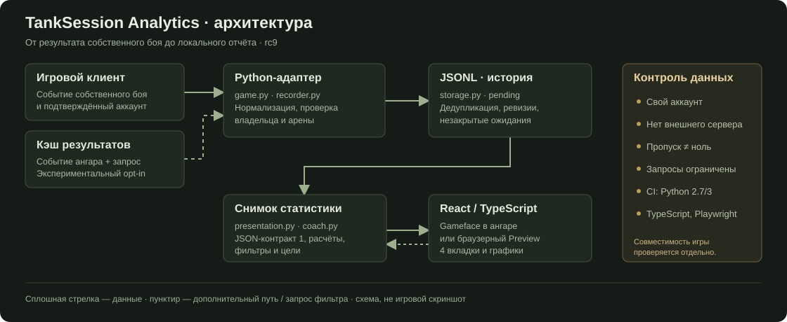

# TankSession Analytics

**Персональная аналитика завершённых боёв для «Мира танков».**


TankSession Analytics собирает собственные послебоевые результаты и превращает локальную историю в наглядные отчёты: динамику урона, сравнение периодов, персональные рекорды, серии исходов и сводки по технике. Интерфейс на **React + TypeScript** доступен в ангаре через **Gameface** и отдельно в браузере. Обработка и хранение данных реализованы на Python; внешние серверы проекта не используются.

[Быстрый старт](START_HERE_RU.md) · [Галерея](docs/SCREENSHOTS_RU.md) · [Архитектура](docs/ARCHITECTURE_RU.md) · [История изменений](CHANGELOG.md) · [Проверка клиента](docs/CLIENT_VALIDATION_RU.md)

> **0.4.0-rc9 — кандидат для испытаний, не стабильный игровой релиз.** В клиенте 1.46.0.0 на предыдущих кандидатах rc4–rc8 подтверждены сохранение собственных завершённых боёв, открытие окна Gameface, интерактивные фильтры, вкладки и центрирование. Сохранение настоящего поражения, восстановление свежего отложенного результата и новые разделы rc9 ещё требуют проверки. Старые пропущенные результаты клиентский кэш не вернул. Проект независимый, не связан с Lesta Games.


*Реальный снимок браузерного интерфейса rc9 на вымышленном сценарии из 20 боёв: среднее растёт, медиана снижается. Это демонстрация расчётов, а не доказательство новой игровой интеграции.*

## Возможности

| Раздел | Что показывает |
|---|---|
| **Прогресс** | Число записанных боёв, доля побед среди известных исходов, средний урон, сравнение двух полных периодов по 10 / 30 / 100 боёв на одной машине, медиана, рекорды и объяснение расчётов |
| **Динамика и цели** | Урон каждого из 24 последних сохранённых боёв с первой записи; цвет столбца и подробности по нажатию; скользящее среднее; личная цель по среднему урону |
| **История боёв** | До 12 последних результатов с пагинацией, техникой, исходом, уроном и опытом из результата |
| **Сводка** | Победы, поражения, ничьи и неизвестные исходы; последняя серия одинаковых известных исходов; средняя помощь по разведке и гусеницам; до 14 дней получения результатов и до 20 машин |
| **Полнота данных** | Незакрытые ожидания своего аккаунта, неполные результаты, диагностика журнала; нулевой урон отличается от неизвестного |

Фильтр техники действует на все разделы. Счётчик незакрытых ожиданий относится ко всему текущему аккаунту, а не к выбранной машине. Ожидание может содержать уже записанный неполный результат: это не число окончательно потерянных боёв. Разбор прогресса не делает выводов о навыке по малой выборке или по одному удачному результату. [Правила Session Coach](docs/SESSION_COACH_RU.md).

| Динамика и цели | Сводка по технике |
| --- | --- |
|  |  |

*Снимки браузерного демо rc9 на синтетических данных. Полные изображения и история боёв — в [галерее](docs/SCREENSHOTS_RU.md).*

## Архитектура



- **Python 2.7** — игровые события, адаптер окна, нормализация, журнал и расчёты. Отдельные инструменты и локальный HTTP-сервер работают на **Python 3.9+**.
- **React 18 / TypeScript / HTML / CSS** — четыре вкладки, транспорт между Python и интерфейсом, проверка JSON-контракта, интерактивные графики.
- **Gameface** — необязательное нативное окно на базе отдельного загрузчика OpenWG Gameface; открытие через F8, закрытие крестиком или предусмотренными клавишами.
- **JSONL** — локальное хранение, ожидания, дополнение неполных записей, дедупликация по аккаунту и бою.
- **GitHub Actions / unittest / Playwright** — проверки Python 3 на Windows и Ubuntu, TypeScript, браузерные сценарии, тесты CPython 2.7, проверяемая воспроизводимая сборка `.mtmod`.

Передача интерфейсу ограничена снимком подтверждённого аккаунта. ID аккаунта и арены не передаются в интерфейс; сторонние игровые ресурсы и бинарные файлы загрузчика не включены. Подробности — в [архитектуре](docs/ARCHITECTURE_RU.md) и [интеграции](docs/integration.md).

## Скачать и попробовать

Проверки программного коммита [48eb7b5](https://github.com/xeemoff/tanksession-analytics/commit/48eb7b5299d2b6a3dd35923ab51493858032634c) прошли во всех пяти заданиях [GitHub Actions](https://github.com/xeemoff/tanksession-analytics/actions/runs/45852504727).

| Пакет | Назначение |
|---|---|
| [Браузерный Preview rc9](https://github.com/xeemoff/tanksession-analytics/actions/runs/45852504727/artifacts/15133368960) | Без установки игры: готовые ресурсы, синтетические бои, Python 3.9+ |
| [Игровой кандидат rc9](https://github.com/xeemoff/tanksession-analytics/actions/runs/45852504727/artifacts/15134990381) | `.mtmod` + SHA-256 для контролируемого испытания, не стабильный релиз |

Артефакты Actions хранятся 14 дней; при истечении срока скачай соответствующий пакет из [последнего успешного запуска](https://github.com/xeemoff/tanksession-analytics/actions/workflows/tests.yml) или собери проект из исходников. Для скачивания может требоваться вход в GitHub.

### Браузерное демо

Распакуй вложенный `TankSession_Analytics_0.4.0-rc9_Preview.zip` и запусти `demo_hangar.cmd` либо:

```powershell
python tools/preview_ui.py --demo
```

Откроется локальная панель с 48 вымышленными боями. Выбери IS-7 и период 10, чтобы увидеть сравнение двух полных периодов. На вкладке «Динамика и цели» переключай урон отдельных боёв и скользящее среднее. На вкладке «Сводка» выбери дни или технику.

Для исходников предварительно собери интерфейс с Node.js 20+:

```powershell
cd ui
npm ci
npm run build
cd ..
python tools/preview_ui.py --demo
```

Для чтения своей истории:

```powershell
python tools/preview_ui.py --data "D:\your-folder\battles.jsonl" --account "ID_АККАУНТА"
```

Адрес по умолчанию — **http://127.0.0.1:8770/**. `--port 0` выбирает свободный порт; `--no-browser` оставляет ручное открытие. Остановка — Ctrl+C.

### Испытание в клиенте

Используй [инструкцию Gameface](docs/GAMEFACE_RU.md) и [пошаговый тест-план](docs/CHECK_CLIENT_RU.md). При закрытой игре пакет устанавливается в папку `mods/<версия клиента>/`; старые версии TankSession нельзя оставлять рядом. Окно Gameface и восстановление через клиентский кэш выключены по умолчанию. При обновлении сохраняй существующий каталог `mods/configs/tanksession_analytics/`.

Контрольная сумма кандидата из CI 45852504727 (SHA-256):

```text
4ABC41E0F7828C3C38BAAEF8C8017F9E10F76460F4EB66F4A3F040BBD90A3D9E
```

## Прежняя панель и CSV на Windows

Нужны **Python 3.9+** и браузер. Дополнительные Python-пакеты для работы панели не требуются.

- Для демонстрации дважды нажми **`demo_dashboard.cmd`**: откроются 48 вымышленных боёв и пример целей.
- Для своей истории запусти **`start_dashboard.cmd`** и выбери папку игры с `paths.xml`. Диалог требует стандартный Tkinter; если он недоступен, используй команды ниже.
- Если мод ещё не записал первый результат, панель покажет ожидание журнала. Нажми обновление страницы после появления данных.
- Для остановки сервера нажми `Ctrl+C` в его консольном окне.

```powershell
python tools/launch_dashboard.py --demo
python tools/launch_dashboard.py --game-dir "D:\Games\Tanki"
python tools/launch_dashboard.py --data "D:\your-folder\battles.jsonl"
```

Если порт занят, добавь `--port 0`: программа выберет свободный и покажет адрес. `--no-browser` оставляет ручное открытие адреса. Для Linux доступны те же Python-команды.

Прежний способ запуска сохранён:

```powershell
python tools/dashboard.py --goals sample_data/goals.json
```

Адрес по умолчанию — **http://127.0.0.1:8765/**. Путь по выбранной папке: `mods/configs/tanksession_analytics/battles.jsonl`. Фактический путь игрового адаптера нужно сверить со строкой `[TankSession] Started; local data path:` в `python.log`.

## Персональные цели

Пример из [sample_data/goals.json](sample_data/goals.json):

```json
[
  {"account_id": "demo", "vehicle": "IS-7", "target_avg_damage": 2700, "window": 10}
]
```

`vehicle` должен точно совпадать с названием в истории. Достоверный стабильный ID техники ещё предстоит подтвердить в клиенте. Указанный `account_id` привязывает цель к аккаунту. Если поле отсутствует, цель применяется отдельно к каждому видимому аккаунту; записи разных аккаунтов никогда не объединяются для достижения цели.

```powershell
python tools/launch_dashboard.py --data "D:\your-folder\battles.jsonl" --goals "D:\your-folder\goals.json"
```

Учитываются текущие фильтры панели. Достижение требует полного окна и известного урона минимум в 70% боёв. Решение принимается до округления среднего; рядом показано число известных значений.

## Надёжность истории

Ключ боя — `(account_id, arena_id)`. Повторный результат может заполнить только отсутствующие поля. Если уже известные показатели противоречат друг другу, новая ревизия отклоняется целиком, а конфликт отмечается в диагностике.

`data_status=complete` означает, что известны **исход, урон и опыт**; нулевые значения допустимы. Это не гарантия наличия всех полей клиента. До получения основных показателей ожидание результата остаётся в отдельном журнале. Полезная ревизия записывается через `write → flush → fsync`; затем обновляется память.

Читатель поддерживает schema 1 и старые записи без явно указанной схемы. Числовые поля ограничены диапазоном `0..2**63-1`; недопустимые типы и версии схемы отклоняются. `timestamp` сохраняет **первое время получения результата**, а не точное время начала боя. Повторное событие не переносит бой на новую дату.

Для проверки истории:

```powershell
python tools/maintain_data.py --data "D:\your-folder\battles.jsonl"
```

Для компактирования **закрой игру и панель**:

```powershell
python tools/maintain_data.py --data "D:\your-folder\battles.jsonl" --compact
```

Команда сохраняет точную резервную копию исходного файла и заменяет журнал последними допустимыми снимками боёв. Проверки изменения файла снижают риск, но не заменяют межпроцессную блокировку. Только один процесс должен записывать историю. Старые версии панели не умеют объединять ревизии rc3; для чтения обновлённой истории используй rc3 или новее.

## Проверки и сборка

```powershell
python -m compileall -q src tools tests
python -m unittest discover -s tests -v
python tools/simulate_capture.py
python tools/generate_ui_fixtures.py --check
python tools/benchmark.py --battles 100000
cd ui
npm ci
npm run typecheck
npm test
npm run build
npx playwright install chromium
npm run test:browser
cd ..
```

[GitHub Actions](https://github.com/xeemoff/tanksession-analytics/actions/workflows/tests.yml) запускает тесты Python 3.9/3.12 на Ubuntu и Python 3.12 на Windows. В набор входят реальные loopback HTTP-запросы, CSV, испорченная история, дополнения, аккаунты и имитация жизненного цикла клиента.

Job **React / TypeScript / browser preview** проверяет транспорт, общие JSON-примеры, настоящую страницу в Chromium и сохраняет снимок браузерного демо. Это проверка браузера, а не встроенного движка Gameface.

Отдельный job **CPython 2.7 / reproducible mtmod** собирает официальный интерпретатор из исходников с закреплённым SHA-256. В нём выполняются шесть runtime-сценариев, настоящая компиляция и сравнение двух независимых сборок. В обычной Python 3 среде два теста, требующие `PYTHON2`, явно пропускаются; это не равнозначно проверке Python 2.7.

После успешного job для нужного коммита доступен artifact `tanksession-mtmod-candidate-...` с пакетом и контрольной суммой. Артефакт хранится 14 дней и предназначен для проверки; автоматическая установка и публичный игровой релиз не выполняются.

Локальная сборка требует предварительно собранного `ui/dist` и отдельного CPython 2.7:

```powershell
python tools/build.py --python2 "C:\Python27\python.exe"
python tools/build.py --verify "dist\ru.tanksession.analytics_0.4.0-rc9.mtmod"
```

`--verify` проверяет состав 12 модулей, пять ресурсов интерфейса/регистрации, метаданные, CRC и заголовки байткода. Он не исполняет архив и не доказывает его поведение. Проверка собственных свежескомпилированных code objects выполняется при сборке. Подробности: [архитектура и инженерные решения](docs/ARCHITECTURE_RU.md).

## Проверка в игре и ограничения

Загрузка и часть функций подтверждены на rc4–rc8. Новый пакет rc9, свежие отложенные результаты, поражения, полные сравнения, заполненный график, цели, пагинация, смена аккаунта, реплей и соответствие действующим правилам требуют дальнейшей проверки. Начни с [пошагового тест-плана](docs/CHECK_CLIENT_RU.md); результаты запиши в [протокол совместимости](docs/CLIENT_VALIDATION_RU.md).

Экспериментальный доступ к `battleResultsCache` **выключен по умолчанию**. Отсутствующие результаты нельзя достоверно восстановить, если клиент их не предоставил. В rc8 сигнатура сверена с доступным справочным кодом ветки 1.46; подключение обработчика и ответы кэша подтверждены, но сохранение свежего отложенного результата пока нет. Включай только для контролируемого испытания.

Мод предназначен для собственной послебоевой истории. Не публикуй реальные журналы, настройки и ID аккаунтов. Для обсуждения проблем есть команда, выводящая только агрегированные счётчики:

```powershell
python tools/diagnose_log.py --log "D:\your-folder\python.log" --json
```

## Материалы

- [Быстрый старт](START_HERE_RU.md) и [галерея](docs/SCREENSHOTS_RU.md)
- [Окно Gameface: подключение и ограничения](docs/GAMEFACE_RU.md)
- [Архитектура и инженерные решения](docs/ARCHITECTURE_RU.md)
- [Проверка клиента](docs/CHECK_CLIENT_RU.md) и [протокол](docs/CLIENT_VALIDATION_RU.md)
- [Подробности интеграции](docs/integration.md)
- [История изменений](CHANGELOG.md) и [план развития](docs/roadmap.md)
- [Правила публикации](docs/PUBLICATION_RU.md)
- [Лицензия MIT](LICENSE)
