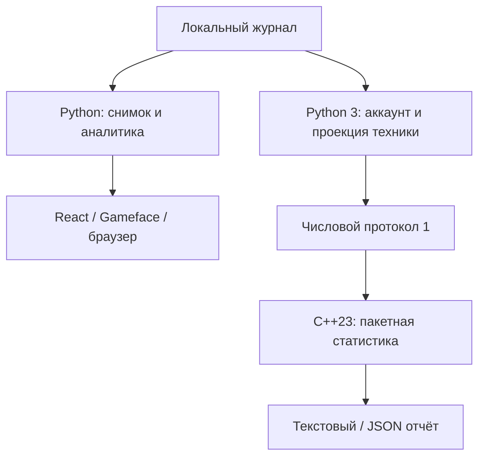
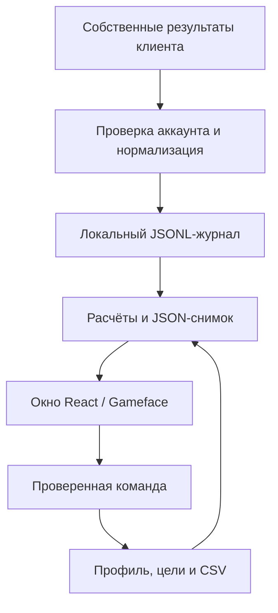

# Архитектура TankSession Analytics 2.0.0-rc3

**2.0.0-rc3 — исправления прокрутки Gameface и обновление через менеджер.** На клиенте 1.46.0.0 в RC2 подтверждены сохранение настроек после перезапуска, подпись техники, пагинация и обновление опыта нового боя после бонуса. Колесо и кнопки прокрутки не работали; эти изменения RC3 требуют новой игровой проверки. Стабильный 2.0.0 ещё не принят. Игровой адаптер написан на Python 2.7, интерфейс — на React/TypeScript, внешний движок — на C++23. Факты и ограничения сохраняются в [протоколе испытаний](CLIENT_VALIDATION_RU.md).

## Новые границы версии 2.0

Игровая ветвь остаётся Python 2.7 → JSONL → Python-снимок → React/Gameface. Метаданные, аналитические разрезы, отчёты, поиск и сортировка расширяют проверяемый контракт, сохраняя чтение старой истории.

Новая нативная ветвь работает **вне процесса игры**: `tools/native_report.py` в Python 3 читает `BattleStore`, отбирает один подтверждённый аккаунт и разрешает идентичность техники. Затем передаёт ограниченный ASCII-протокол в `native/src/main.cpp`. C++ получает числовые группы и показатели без аккаунтов, арен и пользовательских подписей. Вычислительное API находится в `native/include/tanksession/analytics.hpp`, парсер и JSON — в `protocol.hpp`.

Выбор отдельного процесса позволяет использовать C++23 без зависимости от ABI игрового Python. Ошибка companion не влияет на сбор в игре. Цена — подготовка данных, сериализация и запуск процесса; бенчмарк считает эти расходы отдельно. Python-эталон выбирается явно и используется для проверки совпадения, а не для незаметного скрытия ошибок нативного движка.

`insights.build_analytics()` группирует уже отобранные записи по карте, классу, уровню и нации, строит календарь 90 дней и распределение по часам/дням UTC. Метаданные относятся к конкретному бою: нынешний каталог не переписывает старые неизвестные классы или уровни. У групп есть число боёв и полнота метрик; ограничение отображаемых групп сохраняет остаток отдельно.

`build_reports()` формирует последние 7/30 суток и всю историю по времени получения. Для соседнего сравнения используются интервалы одинаковой длительности; будущие записи исключаются со счётчиком. Разности описывают выборки и не утверждают причину изменения результата. Coach добавляет устойчивые показатели разброса и предложение цели; сохранение проходит обычную команду `save_goal` после действия пользователя.

`TankSession-Manager.ps1` содержит WinForms-представление; `Manage-TankSession.ps1` — поиск установки, возврат/удаление и проверку выпусков; `Data-TankSession.ps1` — архивы истории. Проверки пакета и основная установка остаются в `Install-TankSession.ps1`. Архив содержит разрешённые имена, размеры и SHA-256; фактический распакованный размер тоже ограничен. Импорт сначала проверяет снимок, сохраняет нынешние данные, применяет файлы с возможностью возврата и проверяет итоговые байты. Операции выполняются при закрытых игре и панелях; общий lock сериализует операции менеджера, но не превращает JSONL в многопроцессную базу.

Проверка GitHub выполняется только по кнопке: читает метаданные выпусков и выдаёт ссылку. Данные пользователя не отправляются, удалённый код не запускается автоматически.

[Нативное ядро](NATIVE_CORE_RU.md) · [Разбор для собеседования](INTERVIEW_GUIDE_RU.md) · [Контракт данных](DATA_AND_UI_RU.md)

## Обновление менеджера в RC3

`manager.cmd` запускает небольшой `Start-TankSession.ps1` из исходной распакованной папки. Пока указателя нет, открывается исходный менеджер. После успешного обновления `.tanksession-current.json` выбирает отдельную папку версии внутри `.tanksession-updates`. Перед загрузкой нового скрипта bootstrap проверяет список файлов, размеры и хеши из `update-receipt.json` и манифест пакета. Повреждённая версия не исполняется; открывается исходный менеджер с сообщением.

`Update-TankSession.ps1` выполняет ограниченные HTTPS-запросы только по явным кнопкам. Адреса API и исходных assets относятся к точному репозиторию; перенаправления ограничены серверами доставки GitHub. Файл и sidecar проверяются по опубликованному имени, размеру, SHA-256 и digest API при наличии. Архив проверяется целиком до распаковки, его плоский состав разрешён явно; обходы пути, дополнительные файлы, ссылки, повторные имена и превышение размеров отклоняются. `manager_update_protocol: 1` обозначает поддерживаемый формат автономного Windows-архива.

После проверки текущий доверенный установщик сохраняет данные и прежний пакет. Проверка работающей игры повторяется после загрузки. Версия сверяется также с установленными пакетами, чтобы старое окно менеджера не откатило новую установку. Новые скрипты до этого не загружаются. Атомарное переключение указателя — последняя операция успешной установки; отказ переключения попадает в тот же обработчик возврата пакетов. Это откат обработанных ошибок и сохранение копий, а не общая атомарная транзакция файловой системы при потере питания.

Окно закрывается после успешной операции; bootstrap открывает проверенную версию с прежним выбором игры, клиента и канала. Исходные запущенные скрипты не заменяются, повторные обновления используют тот же корневой каталог. Прежняя папка менеджера остаётся для восстановления. Ограниченный формат bootstrap может потребовать отдельного перехода при будущей несовместимой версии протокола; новая схема не делает старый RC2 загрузчиком обновлений.

## Основной поток

[Схема rc9](images/architecture-rc9.svg) сохранена как историческая иллюстрация основного потока чтения. Она не описывает новые команды профиля, целей и экспорта.

## Компоненты и зависимости

| Компонент | Ответственность |
|---|---|
| [game.py](../src/res/scripts/client/gui/mods/tanksession_analytics/game.py) | События клиента, подтверждённый аккаунт, исключение реплеев, жизненный цикл, подключение локального Workspace |
| [core.py](../src/res/scripts/client/gui/mods/tanksession_analytics/core.py) | Нормализация результата, schema 1, полнота основных полей и базовая статистика |
| [vehicles.py](../src/res/scripts/client/gui/mods/tanksession_analytics/vehicles.py) | Ключи типа машины, точное разрешение старых подписей в своём аккаунте, проекция без записи и проверка дополнения идентичности |
| [economy.py](../src/res/scripts/client/gui/mods/tanksession_analytics/economy.py) | Базовый и бонусный опыт, кредитный итог по явно известным компонентам и поддержанному сценарию |
| [recorder.py](../src/res/scripts/client/gui/mods/tanksession_analytics/recorder.py) | Общий путь обычного события и кэша, проверка принадлежности, сохранение и завершение ожидания |
| [storage.py](../src/res/scripts/client/gui/mods/tanksession_analytics/storage.py) | JSONL, дополнение неизвестных полей, дедупликация, pending-журнал и диагностика |
| [recovery.py](../src/res/scripts/client/gui/mods/tanksession_analytics/recovery.py) | Экспериментальный кэш, очередь сигналов готовности, бюджеты, интервалы, токены callback |
| [analytics.py](../src/res/scripts/client/gui/mods/tanksession_analytics/analytics.py), [goals.py](../src/res/scripts/client/gui/mods/tanksession_analytics/goals.py) | Фильтры, окна 10/30/100, скользящее среднее, проверка персональных целей |
| [coach.py](../src/res/scripts/client/gui/mods/tanksession_analytics/coach.py) | Среднее и медиана двух полных окон одной машины, локальные рекорды |
| [insights.py](../src/res/scripts/client/gui/mods/tanksession_analytics/insights.py) | Дополнительные метрики с числом наблюдений, сводка по ID карты, сессии по времени получения результатов |
| [presentation.py](../src/res/scripts/client/gui/mods/tanksession_analytics/presentation.py) | Граница Python/JS: проверка запроса, выбор своего аккаунта, снимок, все страницы истории |
| [workspace.py](../src/res/scripts/client/gui/mods/tanksession_analytics/workspace.py) | Профиль текущего аккаунта, цели, запись с восстановлением при прерывании, явный CSV-экспорт |
| [gameface.py](../src/res/scripts/client/gui/mods/tanksession_analytics/gameface.py) | Необязательный внешний загрузчик, нативное окно, команды, F8/Esc, таймеры и смена поколения окна |
| [ui/](../ui/) | React/TypeScript, проверка JSON-контракта, транспорт, история, сводки и настройки |
| [tools/preview_ui.py](../tools/preview_ui.py) | Браузерный просмотр того же контракта через loopback; один аккаунт задаётся при запуске |
| [tools/dashboard.py](../tools/dashboard.py) | Прежняя внешняя панель Python 3, фильтры по датам, локальные таблицы и экспорт |

Собственные Python-модули игрового пакета, включая точку входа и `__init__.py`, рассчитаны на CPython 2.7. Состав проверяется явным manifest сборщика. Внешние инструменты требуют Python 3.9+. Браузерный сервер не импортирует игровой адаптер. OpenWG Gameface устанавливается отдельно; код и бинарные файлы внешнего загрузчика и клиента не включены в проект.

## Инварианты журнала

Один логический бой определяется парой `(account_id, arena_id)`. Повторное событие не увеличивает число боёв. Контекст начала боя помогает сохранить принадлежность и технику после выхода в ангар. Разные подтверждённые аккаунты не объединяются; противоречие сохранённого и текущего аккаунтов приводит к отказу.

Старое значение аккаунта `local` означает неизвестную принадлежность. Такая запись может подавлять повтор арены, но автоматически не получает данные другого подтверждённого аккаунта.

Неизвестное значение хранится как `null`, известный ноль остаётся нулём. `complete` по-прежнему означает известные исход, урон и полученный опыт. Карта, выживание, помощь, стрельба, экономика и базовая строка опыта не являются обязательными для этого статуса.

Schema 1 расширена необязательными полями без переписывания старых строк. `BattleStore.upsert()` заполняет отсутствующие значения, включая новые поля. При конфликте известного значения предлагаемая ревизия отклоняется целиком. Первое известное время получения результата сохраняется. Исходные строки остаются в файле; при чтении ревизии объединяются по тем же правилам.

Идентичность техники отделена от исходной подписи: `vehicle_id` хранит числовой тип либо точное внутреннее имя. Чтение строит проекцию только своего аккаунта, разрешая прежние подписи по однозначным точным наблюдениям. Исходный журнал и старый профиль при этом не меняются. Неоднозначные группы остаются отдельными; их история доступна, но они не подтверждают одну машину для сравнений.

Доказанное дополнение того же боя может повысить ключ имени до числового типа отдельной ревизией. При этом проверяются аккаунт, арена, нация и непротиворечивость внутренних имён. Изменение подписи при доказанной идентичности не является конфликтом: первая подпись остаётся в журнале. Разные числовые типы и противоречащие известные показатели по-прежнему отклоняют всю ревизию.

Запись, `flush()` и `fsync()` предшествуют изменению состояния в памяти. Размер строки чтения ограничен. Диагностика различает некорректный JSON, нарушение схемы, дубликаты, ревизии и конфликты. Обычное чтение не изменяет журнал.

JSONL рассчитан на один процесс записи. [maintain_data.py](../tools/maintain_data.py) выполняет отдельную проверку и компактирование с резервной копией при закрытых игре и панелях. Настройки профиля и экспорт не компактируют и не очищают историю.

## Расчёты и смысл данных

Подробная схема находится в [DATA_AND_UI_RU.md](DATA_AND_UI_RU.md). Новые игровые поля сопоставлены со справочной декомпиляцией **1.46.0.0_CT**, коммитом [e241d4d](https://github.com/StranikS-Scan/WorldOfTanks-Decompiled/commit/e241d4d04d610f0747271ff6f044ee809a607b53). Это не доказательство тождественности установленному клиенту; наличие и смысл полей ещё нужно сверить в игре.

- `map` содержит стабильный идентификатор вида `arena:11`, без предположения о локализованном названии.
- `xp_base` получается только из известных корректных `originalXP` и `achievementXP` как их разность при неотрицательном результате. Из полученного `xp` и премиум-множителя он не выводится.
- `xp_bonus` — неотрицательная разность полученного `personal.xp` и `xp_base` при известных компонентах; это итог сверх базовой строки, без разложения по отдельным бонусам.
- `credits_gross` соответствует полю `credits`. `credits_net` рассчитывается с обоими скорректированными удержаниями, событиями наград avatar и фактическими кредитными расходами на ремонт, снаряды и снаряжение. Требуются код режима 1/22/24, одна машина, подтверждённый собственный avatar и все компоненты. Другие валюты, складские предметы и будущая копилка не включаются; неизвестное не подменяется нулём.
- Средние дополнительных метрик сопровождаются числом известных значений. Точность и пробития считают доли по парам известных совместимых числителя и знаменателя.
- Сессии разделяются интервалом **60 минут или больше** между получением соседних результатов. Группировка выполняется по своему аккаунту до фильтра техники.
- Сравнение двух последних выбранных сессий требует одной известной машины, одного известного режима, минимум 10 записей в каждой и полного урона в обеих. `unknown` и код режима `0` не подтверждают режим.
- Время получения не позволяет установить время начала боя, длительность игры или причины изменения результатов.

[Session Coach](SESSION_COACH_RU.md) остаётся отдельным расчётом двух непересекающихся окон 10/30/100. Новое поле опыта не включено в выводы о прогрессе. Цель достигается только на полном окне с известным уроном; сравнение с порогом происходит до округления.

В 2.0 RC2 дополнительный XP после пользовательского применения бонуса учитывается отдельным событием `additional_xp`. Игровой адаптер сначала наблюдает предложение конкретной арены, своего аккаунта и одной машины, затем проверяет успешный флаг сервиса. Хранилище требует тот же исходный XP и дописывает одну поправку; повторный сигнал не добавляет второй бонус. Обычный `upsert` сохраняет строгие конфликты известных полей. При чтении и компактировании сохраняются база и происхождение поправки; UI и C++-адаптер получают один эффективный результат. Агрегат опыта сессии для изменения боя не используется. [Точный контракт и источники](DATA_AND_UI_RU.md).

## Контракт и команды интерфейса

Протокол сохраняет номер **1**. Новые поля запроса: `page`, `action`, `preferences`, `goal`. В снимке добавлены необязательные `pagination`, `metrics`, `sessions`, `workspace`; ранее существовавшие `coach` и `insights` сохраняются.

RC2 использует selector в `vehicles[].name`, выборе `vehicle`, целях и фильтрах. Необязательные `label` и `vehicle_label` предназначены для отображения. `xp_bonus` также добавлен необязательным полем деталей и сводной метрики. Старые снимки без новых подписей и показателя допустимы; старые ключи разрешаются только по точным данным собственного аккаунта.

При запросе с `page` история охватывает все выбранные записи по пять на страницу. Старый запрос без `page` сохраняет прежний ответ с последними 12 результатами. Старые JSON-примеры без новых возможностей остаются доступными для чтения; интерфейс не изображает поддержку отсутствующих команд.

Python проверяет список полей, типы, размеры, допустимые действия и значения. UI не выбирает аккаунт, путь записи или имя файла. Снимок не передаёт ID аккаунта и ID боя. `map` является идентификатором типа арены, а не идентификатором отдельного боя. Основные числа за пределами точного целого JS отклоняются; слишком большие дополнительные числа скрываются с диагностикой без потери читаемых основных показателей.

В Wulf-модели одна JSON-строка `payload`, команды `onRequest` и `onClose`. Запросы просмотра объединяются на **150 мс** с сохранением последнего выбора. Команды сохранения и экспорта сохраняют порядок в ограниченной очереди и не объединяются с другими записями. Автоматическое обновление после команды повторяет только чтение. Старый запрос просмотра не заменяет ID последнего выполненного действия.

Контекст открытого окна проверяется каждые 0,5 с без пересчёта журнала. Пересчёт выполняется при открытии, запросе или обновлении истории. Перед передачей в JS аккаунт проверяется повторно. При закрытии модель очищается, таймеры отменяются, окно уничтожается; старые callback не воздействуют на новое окно.

## Профили, цели и экспорт

Профиль хранится рядом с журналом в `profiles/<SHA-256 аккаунта>.json`. Он содержит настройки вида, стартовый фильтр, вкладку и персональные цели. Явное сохранение пишет версию 2 с каноническими selectors; версия 1 читается без перезаписи с сохранением смысла прежних строковых подписей. Версии журнала и UI-протокола остаются 1. Сам ID аккаунта в содержимое профиля не записывается; имя по хешу не является шифрованием.

Новый профиль использует прежний `goals.json` только как источник целей для чтения. После первого изменения списка целей профиль содержит собственный список, который заменяет наследование legacy-целей. Пустой список означает отсутствие целей. Старый `goals.json` не переписывается.

Legacy-файл читается только при наследовании. Его ошибка не блокирует корректный собственный список целей профиля. Если нужен повреждённый профиль или legacy-файл, окно сообщает ошибку чтения и не записывает поверх него настройки.

Профиль сначала полностью записывается во временный файл в том же каталоге, выполняются `flush` и `fsync`. Если доступны `os.replace` либо Windows `MoveFileExW`, используется атомарная замена. В урезанном Python 2 без `ctypes` прежний файл переименовывается в `.rollback`, затем устанавливается новый; при отказе возвращаются прежние байты. Это восстанавливаемая последовательность для одного писателя, а не атомарная транзакция нескольких файлов. После прерывания валидный существующий профиль считается завершённой записью; при его отсутствии восстанавливается только проверенная ограниченная копия `.rollback`. Если существующий профиль повреждён, обе копии сохраняются и возвращается ошибка чтения.

Предыдущая версия дополнительно сохраняется в `.bak`; её замена защищена теми же правилами. Ограничены размер профиля, число профилей и число целей. Отказ команды возвращает `write_failed` вместе с прежним доступным снимком истории и настроек. Диагностика содержит только название операции и класс ошибки. Повторные доставки одной команды учитываются в ограниченном кэше выполненных операций текущего открытия.

CSV создаётся только по явной команде. Экспорт охватывает всю историю выбранной техники либо всю технику своего аккаунта при пустом фильтре; окно сравнения и текущая страница его не сокращают. Формат: UTF-8 с BOM, разделитель `;`, кавычки, защита текстовых ячеек от интерпретации как формул. Сохраняются подпись техники, её необязательный ключ типа, базовый/бонусный опыт и известные кредиты. ID аккаунта и боя исключены. Файлы создаются с уникальными именами в `exports/` и не заменяют прошлые экспорты.

## Браузерный просмотр

Для своей истории `preview_ui.py` по умолчанию разрешает только чтение. Флаг `--allow-write` разрешает настройку профиля, целей и экспорт рядом с указанным журналом. История при этом не изменяется. Демонстрация использует отдельное временное хранилище и не меняет `sample_data`.

Команды поступают только через `POST /api/command` с JSON и заголовком `X-TankSession-Request: 1`. Проверяются Host, Origin, размер тела и перечень полей; сервер слушает loopback и не открывает CORS. GET не выполняет сохранение. Собственный аккаунт закреплён параметром запуска, HTTP-запрос не может его изменить.

## Отложенные результаты и границы проверки

Кэш выключен по умолчанию. Готовые результаты своего аккаунта ставятся в очередь до 32 арен и не теряются из-за другого активного запроса. Повторные сигналы объединяются. В игровом адаптере один проход запускает максимум один запрос; потерянный callback истекает через 60 секунд. Для обычного повтора действует интервал 15 секунд; явный сигнал готовности допускает одну раннюю попытку.

После входа, события ангара или готовности выполняются не более четырёх повторных проверок с интервалом 20 секунд. Выход из ангара, смена аккаунта, повторный вход и остановка отменяют отложенную работу. Токены попыток и таймеров защищают от поздней доставки. Отсутствующий у клиента результат не создаётся искусственно.

Автотесты, реальный CPython 2.7, сборка и браузерные испытания проверяют разные части проекта. Ни один из этих уровней не подтверждает новый нативный интерфейс в игре. Актуальные результаты CI и живых сценариев публикуются отдельно в [CLIENT_VALIDATION_RU.md](CLIENT_VALIDATION_RU.md); условия распространения — в [PUBLICATION_RU.md](PUBLICATION_RU.md).
