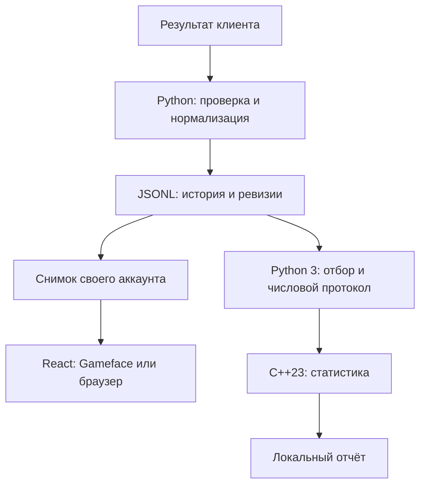

# Как разобраться в TankSession и рассказать о нём на собеседовании

Этот документ — маршрут будущего изучения версии 2.0. Сначала завершаем функциональную проверку и полировку, затем разбираем код по порядку. Цель — уметь проследить данные, объяснить решения и изменить проект самостоятельно. Заученный текст без понимания этого не заменит.

Описания ниже связаны с исходниками. Фактический статус проверки хранится в [отчёте готовности](READINESS_2_0_0_RU.md), а реальные игровые наблюдения — в [протоколе](CLIENT_VALIDATION_RU.md). Нельзя выдавать браузерный тест за запуск в игре, наличие C++ за доказанное ускорение клиента или чужую помощь в реализации за собственную работу без участия инструментов.

## 1. Что за продукт и какую задачу он решает

TankSession собирает **собственные завершённые результаты** и сохраняет локальную историю. На её основе пользователь видит изменения урона, результаты на разных машинах и картах, экономику, активность, отчёты и личные цели. В ангаре работает React-интерфейс через Gameface; тот же интерфейс можно открыть в браузере. Отдельный C++-процесс рассчитывает статистику локального журнала вне игры.

На вопрос «что вы сделали?» сначала достаточно назвать пользователя, входные данные и результат. Далее стоит раскрыть одну действительно сложную инженерную часть: например, поздний результат после смены аккаунта, дополнение неполного боя без дублей или совместимость числового протокола Python/C++.

Хорошая короткая формулировка после освоения кода:

> Это локальная система послебоевой аналитики для «Мира танков». Игровой Python-адаптер нормализует результаты и ведёт журнал с дедупликацией и безопасными дополнениями. React показывает проверяемые сводки и цели, а отдельный C++23-движок строит пакетные отчёты. Я могу объяснить путь одного результата, правила данных, ограничения интеграции и тесты отказов.

Последнее предложение нужно подтверждать практикой. Рассказ о помощи ИИ и проверке сгенерированных изменений должен соответствовать тому, что действительно было сделано и изучено.

## 2. Карта системы

Это две ветви чтения одной истории. C++ не подгружается в игровой Python и не вызывается из обработчика боя. Его ошибка не должна останавливать сбор результатов.

| Часть | Основные файлы | За что отвечает |
|---|---|---|
| Вход в мод | [mod_tanksession_analytics.py](../src/res/scripts/client/gui/mods/mod_tanksession_analytics.py), [game.py](../src/res/scripts/client/gui/mods/tanksession_analytics/game.py) | Подключение событий, жизненный цикл, текущий аккаунт и игровой контекст |
| Нормализация | [core.py](../src/res/scripts/client/gui/mods/tanksession_analytics/core.py), [economy.py](../src/res/scripts/client/gui/mods/tanksession_analytics/economy.py) | Допустимые типы, исход, известные показатели, формулы |
| Техника | [vehicles.py](../src/res/scripts/client/gui/mods/tanksession_analytics/vehicles.py) | Стабильный selector, подпись, точные соответствия и неоднозначность |
| История | [storage.py](../src/res/scripts/client/gui/mods/tanksession_analytics/storage.py), [recorder.py](../src/res/scripts/client/gui/mods/tanksession_analytics/recorder.py) | Запись, чтение, ревизии, принадлежность результата |
| Поздние результаты | [recovery.py](../src/res/scripts/client/gui/mods/tanksession_analytics/recovery.py) | Ограниченная очередь, повторы и защита от старых callback |
| Представление | [presentation.py](../src/res/scripts/client/gui/mods/tanksession_analytics/presentation.py), [insights.py](../src/res/scripts/client/gui/mods/tanksession_analytics/insights.py) | Снимок UI, фильтры, страницы, аналитика и отчёты |
| Coach и цели | [coach.py](../src/res/scripts/client/gui/mods/tanksession_analytics/coach.py), [goals.py](../src/res/scripts/client/gui/mods/tanksession_analytics/goals.py) | Сопоставимость выборок, разброс, предложение и проверка цели |
| Пользовательский профиль | [workspace.py](../src/res/scripts/client/gui/mods/tanksession_analytics/workspace.py) | Настройки аккаунта, команды, атомарная запись и CSV |
| Мост и интерфейс | [gameface.py](../src/res/scripts/client/gui/mods/tanksession_analytics/gameface.py), [ui/src](../ui/src) | Проверенный обмен JSON, React и взаимодействие |
| C++ | [native](../native), [native_report.py](../tools/native_report.py) | Числовое ядро, CLI и внешний адаптер |
| Поставка | [installer](../installer), [build.py](../tools/build.py), [package_release.py](../tools/package_release.py) | Менеджер Windows, пакеты, копии, хеши и условия выпуска |

## 3. Проследить один бой

Сначала ищем обработчик начала собственного боя и сохранение контекста: аккаунт, арена, техника, известные метаданные. Затем ищем обработчик результата. Полученный объект не превращается сразу в строку файла: сначала выбирается собственная запись, сверяется принадлежность и нормализуются показатели.

Далее `ResultRecorder` передаёт запись в `BattleStore`. Ключ логического боя — **пара аккаунт/арена**. Повтор того же результата не создаёт новый бой. Если первое событие было неполным, более полное событие может заполнить отсутствующие поля. Изменение уже известных значений считается конфликтом; оно не должно незаметно заменить историю.

Полезная ревизия добавляется новой строкой. При чтении физические строки сворачиваются в логические бои. Поэтому «в файле 100 строк» не означает «сыграно 100 боёв». Успешное сохранение включает запись, `flush` и `fsync`; память обновляется после надёжной записи.

**Проверка понимания:** придумать четыре события для одного боя: неполное, полное, повтор полного и противоречивое. До запуска теста предсказать количество логических боёв, физические строки, известные поля и диагностику. Затем найти соответствующий тест и проверить предсказание.

## 4. Почему JSONL, а не база данных

JSONL удобен для небольшого локального инструмента: запись дописывается, формат виден в редакторе, нет отдельного сервера и зависимости от СУБД в старом игровом интерпретаторе. Оборванную последнюю строку можно обнаружить, не теряя все предыдущие результаты.

Цена решения: чтение журнала, хранение индекса в памяти, ограниченная модель конкурентной записи и рост файла из-за ревизий. Журнал рассчитан на одного записывающего процесса. Компактирование выполняется отдельным инструментом при закрытых игре и панелях; оригинальные байты резервируются.

SQLite могла бы дать транзакции, индексы и удобные запросы. Это возможный следующий выбор при доказанной потребности, но он добавил бы вопросы поставки, миграций и совместимости с игровым окружением. На собеседовании нужно уметь назвать обе стороны решения, а не объявлять выбранный формат универсально лучшим.

## 5. Неизвестное значение и ноль

Для урона `0` — наблюдение, а `null` — отсутствие допустимого значения. Если известны `0`, `1000` и один пропуск, средний известный урон равен `500`, покрытие — два боя из трёх. Деление на три подменило бы отсутствие данных нулевым результатом.

Победы делятся на число известных исходов. Для точности нужна допустимая пара выстрелы/попадания в одном бою. Чистые кредиты могут быть отрицательными; отрицательный доход нельзя отбрасывать как ошибку только из-за знака.

`complete` имеет узкое определение: известны исход, урон и полученный опыт. Оно не утверждает, что найдены все поля карты, техники и экономики. Новое необязательное поле должно оставлять старую историю читаемой.

**Проверка понимания:** добавить в отдельной ветке необязательную вымышленную метрику и пройти путь нормализация → хранение → покрытие → контракт → отображение. Затем удалить учебное изменение. Нельзя ограничиться красивой карточкой, если внизу данных нет.

## 6. Идентичность техники и аккаунта

Отображаемое название не является идентификатором. Оно может измениться, быть переведено или совпасть у разных типов. `vehicle_id` хранит подтверждённый тип либо точное внутреннее имя, а подпись предназначена для человека.

Прежние строки со свободными названиями не переписываются. Проекция строится только по данным одного подтверждённого аккаунта. Точное однозначное соответствие может связать прежнюю подпись с типом; похожее написание не является доказательством. Неоднозначная группа остаётся видимой, но не используется как одна достоверно определённая машина для Coach и достижения целей.

Важно различать ID сущности машины в конкретном бою и дескриптор типа техники. Подмена одного другим даёт правдоподобные, но неверные группы.

**Вопросы:** почему сначала отбирается аккаунт, а затем разрешаются старые подписи? Что произойдёт, если два типа имели одинаковую подпись? Почему хеш имени профиля не является шифрованием? Где интерфейс получает selector, а где label?

## 7. Поздний результат и жизненный цикл

Игровое событие не гарантирует синхронную готовность всех данных. Пользователь может выйти в ангар, начать другой бой или сменить аккаунт раньше ответа кэша. Контекст начала боя и очередь восстановления помогают обработать этот порядок событий.

Повторы ограничены по числу, интервалу и времени ожидания. Запрос не должен ждать callback бесконечно. Старый callback после смены контекста не должен записывать результат в новый аккаунт или открыть закрытое окно. Для этого проверяются принадлежность, состояние и токены текущих попыток.

Не все потери восстановимы: если клиент больше не предоставляет результат, мод не может его достоверно придумать. Статус `not_available` и незакрытое ожидание должны объяснять этот предел.

**Проверка понимания:** нарисовать последовательность «выход из боя → запрос → смена аккаунта → поздний ответ» и указать конкретную проверку, которая отвергает ответ. Затем найти тест, где порядок событий воспроизводится без запуска клиента.

## 8. Расчёты, Coach и смысл рекомендаций

Coach сравнивает непересекающиеся окна на одной подтверждённой машине. Для содержательного сравнения нужны известные показатели, достаточное число записей и сопоставимый режим. Среднее и медиана отвечают на разные вопросы: несколько сильных результатов могут поднять среднее при почти неизменной медиане.

В 2.0 добавлены квартильный размах и медианное абсолютное отклонение. Это характеристики разброса сохранённой выборки. Меньший разброс не доказывает улучшение навыка; выбор машин, режимов, времени и случайность могут влиять на результат.

Предложение цели — прозрачное правило продукта: **на 5% выше среднего недавнего окна с округлением вверх до 50 урона** при допустимой сопоставимой выборке. Оно не является прогнозом, машинным обучением или оценкой «оптимального» результата. Пользователь явно принимает цель, после чего используется обычная команда сохранения.

Отчёты за неделю и месяц используют последние 7 и 30 суток и соседний интервал той же длины. Время — получение результата в UTC, а не неизвестное точное время игры. Смена состава техники между периодами делает разность описательной; она не становится измерением роста навыка.

**Проверка понимания:** построить пример, где среднее растёт, а медиана падает; пример с одинаковым средним и разным разбросом; пример, где новые танки меняют общий средний урон без изменения результата на каждой машине.

## 9. Контракт Python ↔ React

Python формирует снимок, React проверяет его структуру и отображает. TypeScript помогает при сборке, но входящий JSON существует во время выполнения: поэтому runtime-валидация не исчезает после добавления интерфейсов TypeScript.

UI не выбирает аккаунт или путь файла. Команды содержат ограниченные действия и значения, а Python проверяет их повторно. Пагинация, поиск и сортировка выполняются по всей выбранной истории до выдачи страницы. Обычный запрос просмотра не должен повторно выполнить экспорт или сохранение.

В Gameface используется Wulf-модель и JSON payload. В браузере те же правила доступны через loopback HTTP-сервер. Проверки Host/Origin, лимиты тела и отсутствие произвольных путей защищают локальные команды от случайного вызова чужой страницей. Сам факт адреса `127.0.0.1` не делает любые запросы доверенными.

**Проверка понимания:** проследить нажатие «Сохранить настройки» до файла профиля. Назвать проверки до записи, способ сохранения старой версии и поведение при ошибке. Затем объяснить, как старый снимок без полей 2.0 продолжает читаться.

## 10. C++23: отдельное ядро и граница процесса

Python 3 читает журнал штатным `BattleStore`, отбирает аккаунт, разрешает технику и формирует плотные числовые номера групп. C++ получает только числовые строки: исход и необязательные показатели. Он не должен повторно реализовывать игровые правила принадлежности, миграцию профилей или разбор исходного JSONL.

Публичная функция ядра принимает `std::span<const Battle>`: это представление чужого массива без копирования и без владения. `std::optional` различает измерение и пропуск. `std::expected` возвращает результат либо описанную ошибку. Контейнеры владеют памятью через RAII; `span` не должен пережить исходный контейнер.

Парсер допускает только версию протокола и формат, которые понимает. Ограничены строки, группы и абсолютные значения метрик. Суммы помещаются в `int64_t` благодаря совместным ограничениям числа записей и значений. В JSON сумма записывается десятичной строкой, чтобы потребитель JavaScript не потерял точность после `2^53 - 1`.

Статистика включает средние, выборочную дисперсию, стандартное отклонение и процентиль R7. Разные способы вычисления квартилей могут дать разные числа на короткой выборке; нельзя механически сравнивать квартиль Coach с другим определением процентиля в companion. Определения явно записаны в контракте.

Нативная ошибка не скрывается тихим переходом на Python: эталонный режим выбирается явно. Это позволяет заметить проблему поставки бинарника или несовпадение протокола.

**Что нужно уметь объяснить на C++-собеседовании:** время жизни `span`, отличие `optional` от фиктивного нуля, обработку ошибок без исключений на ожидаемом неверном вводе, переполнение, погрешность `double`, детерминированный порядок, сложность сортировки для процентилей и границы ABI между процессами. Подробности и команды — [NATIVE_CORE_RU.md](NATIVE_CORE_RU.md).

## 11. Как доказать корректность и пользу

| Уровень проверки | Что доказывает | Чего не доказывает |
|---|---|---|
| Python unit/integration | Правила на известных входах, ревизии, аккаунты, HTTP и ошибки | Наличие этих API в установленной игре |
| TypeScript и UI unit | Типы, проверки контракта, компоненты и команды | Вёрстку конкретного встроенного браузера |
| Playwright | Фактический React-рендер и пользовательские действия в Chromium | Работу нового пакета в Gameface |
| CPython 2.7 | Совместимость языка и байткода с выбранным интерпретатором | Полную совместимость клиента |
| Windows PowerShell | Операции с файлами, резервирование, возврат и ошибки | Права и окружение каждого компьютера |
| GoogleTest/parity | Числовой протокол, алгоритм и совпадение C++/Python | Превосходство скорости на любых данных |
| ASan/UBSan | Ошибки памяти и неопределённое поведение на выполненных путях | Отсутствие всех возможных дефектов |
| Живой протокол | Наблюдавшиеся сценарии конкретного пакета и клиента | Автоматическую совместимость с будущим патчем игры |

В бенчмарке отдельно измеряются подготовка истории, запуск/протокол C++ и Python-эталон. Если подготовка занимает основную часть времени, ускорение вычислительного ядра не превращается в такое же ускорение всего пути. Нужно указывать среду, размер данных, число повторов и способ агрегирования замеров. «C++ всегда быстрее» — непроверяемая формулировка для рассказа об этом проекте.

## 12. Установка, сохранность данных и релиз

Менеджер проверяет состав пакета, хеши и целевой клиент. Перед заменой пакетов создаются копии; перед импортом снимка сохраняется нынешняя история. В тестах намеренно повреждаются хеши и моделируются отказы после записи, чтобы проверить реальный откат.

SHA-256 подтверждает соответствие байтов опубликованному значению. Он сам по себе не доказывает доверие к издателю и не заменяет подпись. Фиксированные даты и порядок ZIP делают упаковку воспроизводимой при одинаковых входах и среде.

Стабильный release gate требует живого протокола, точной версии клиента и хеша испытанного `.mtmod`. При смене Python, JS, CSS или метаданных пакет меняется. Успешное испытание старого хеша не является свидетельством для нового.

## 13. Порядок будущих занятий

Работаем небольшими блоками: **два конкретных действия за подход**. Сначала объяснение своими словами, затем упражнение или отладка. Если объяснение не сходится с кодом, возвращаемся к примеру, а не заучиваем новую формулировку.

1. Запустить демо и проследить один результат до снимка UI.
2. Разобрать нормализацию и написать пример с нулём, пропуском и конфликтом.
3. Проследить сохранение ревизии и воспроизвести оборванную строку.
4. Разобрать идентичность машины и изоляцию аккаунтов.
5. Воспроизвести поздний callback и объяснить отмену старого контекста.
6. Проверить формулы Coach и построить контрпример поспешному выводу.
7. Провести команду React → Python → профиль и обратно.
8. Собрать C++, вручную подать маленький протокол и объяснить каждое число отчёта.
9. Изменить алгоритм или формат в учебной ветке и добавить содержательный тест.
10. Снять бенчмарк, объяснить узкое место и только потом выбрать оптимизацию.
11. Проверить отказ импорта/установки на тестовых папках и собрать пакет.
12. Провести пробное собеседование: 2 минуты о продукте, 10 минут об архитектуре, затем глубокий разбор одного модуля и небольшая правка кода.

Критерий готовности: без подсказки восстановить путь данных, назвать ограничения, найти нужный модуль, воспроизвести дефект и объяснить, почему исправление верно. Полный построчный пересказ каждого файла не нужен; понимание связей и способность работать с кодом нужны.
