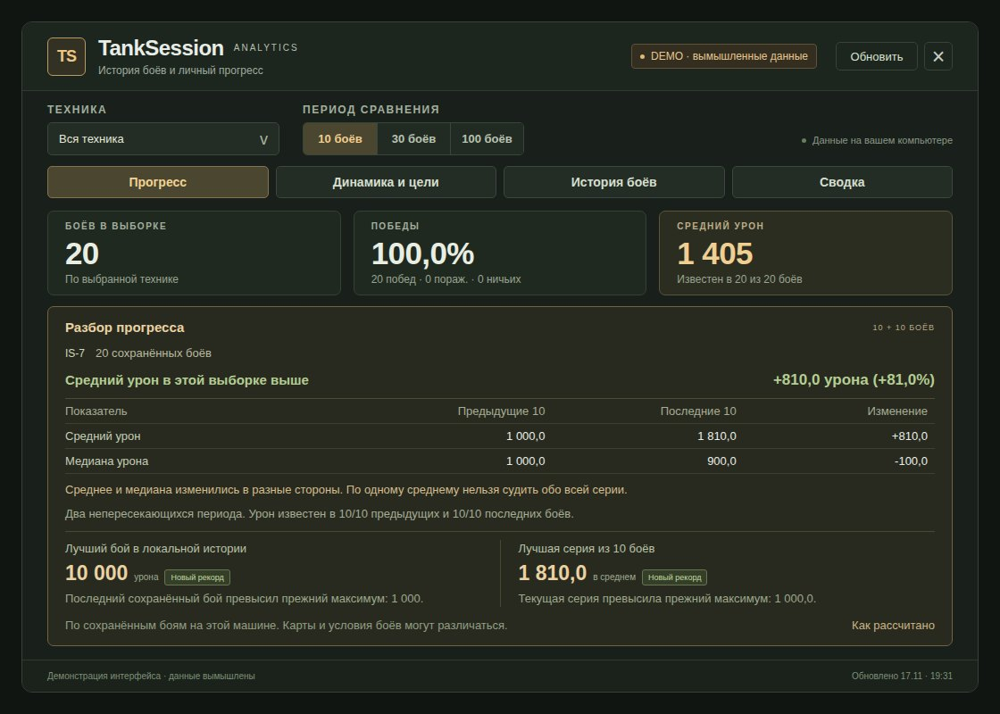

# Галерея TankSession Analytics 0.4.0-rc9

Снимки получены из **настоящего React-интерфейса** в Chromium (1120 × 800) на вымышленных данных. Оригинальная игровая история, логины, идентификаторы, скриншоты ангара и чужие игровые ресурсы не публикуются. Снимки подтверждают браузерный вид, а не совместимость rc9 с Gameface.

Источник: [браузерный тест rc9, CI 45853225132](https://github.com/xeemoff/tanksession-analytics/actions/runs/45853225132). Исходные снимки преобразованы в JPEG при захвате для компактного хранения в репозитории.

## Прогресс

Специальный сценарий из 20 вымышленных боёв: среднее и медиана меняются в разных направлениях.

## Динамика и цели

Урон отдельных сохранённых боёв и переключатель скользящего среднего. Столбец можно выбрать для получения подробностей.

## История боёв

Постраничный список собственных результатов с исходом, уроном и опытом.

## Сводка

Разбивка исходов, последняя серия сохранённых результатов, помощь и сводная таблица техники.

## Посмотреть самостоятельно

[Быстрый старт](../START_HERE_RU.md) · [Кандидат rc9 и Preview](../README.md#скачать-и-попробовать) · [Протокол фактической проверки в игре](CLIENT_VALIDATION_RU.md).
