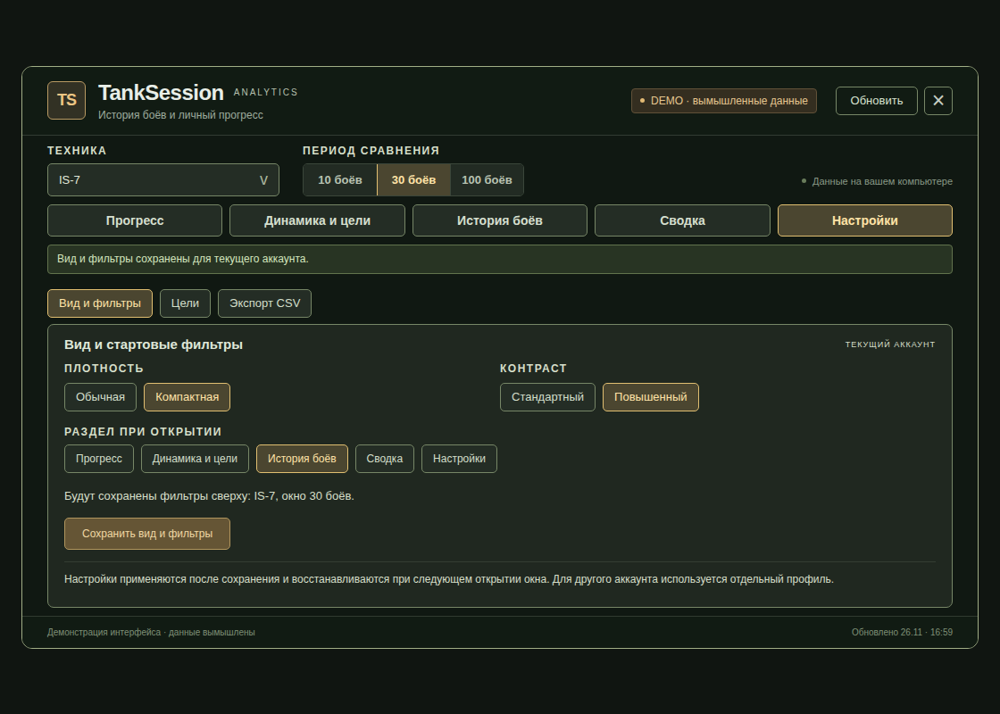
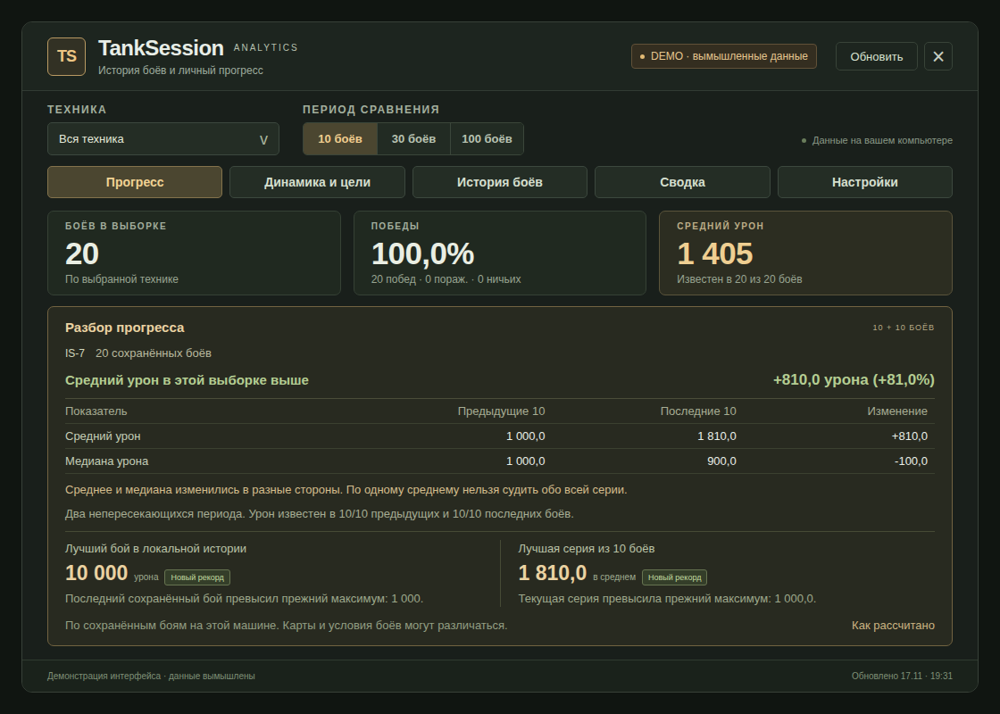
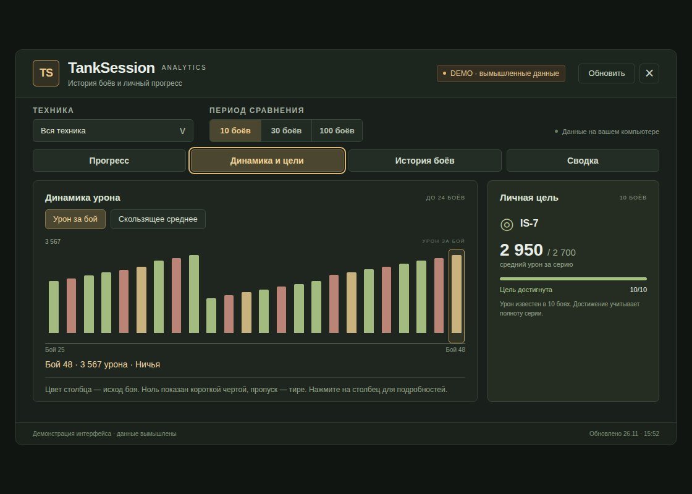
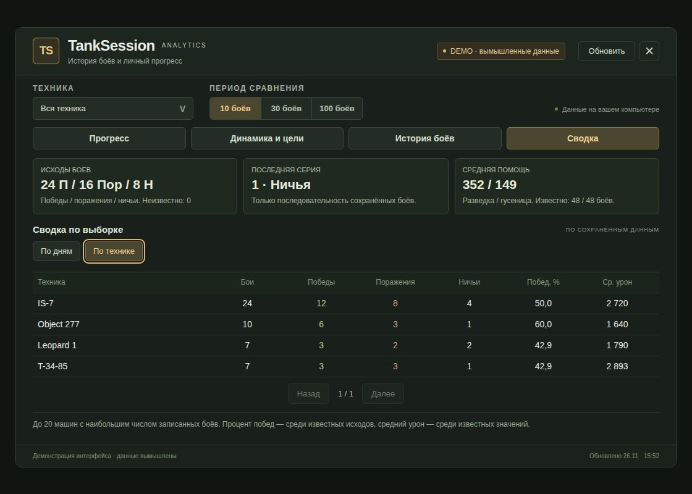

# Галерея TankSession Analytics

## Кандидат 1.0.0-rc1

Снимки ниже получены из настоящего React-интерфейса в Chromium (1120 × 800) на вымышленных данных. Это браузерная проверка; они не подтверждают работу новой версии в нативном Gameface.

Источник: [CI 45863618520, коммит 6f657a4](https://github.com/xeemoff/tanksession-analytics/actions/runs/45863618520), задание React / TypeScript / browser preview: **14 сценариев прошли**. Windows-задание в этом первом запуске обнаружило ошибки установщика и CLI; их исправления и повторные проверки перечислены в [отчёте](READINESS_1_0_0_RU.md). PNG скопированы из артефакта без изменения содержимого.

### Полная история

### Личные цели

### Настройки вида

### Дополнительные показатели

### Сессии

### Разбор прогресса

## Архив: 0.4.0-rc9

Снимки получены из **настоящего React-интерфейса** в Chromium (1120 × 800) на вымышленных данных. Оригинальная игровая история, логины, идентификаторы, скриншоты ангара и чужие игровые ресурсы не публикуются. Снимки подтверждают браузерный вид, а не совместимость rc9 с Gameface.

Источник: [браузерный тест rc9, CI 45853225132](https://github.com/xeemoff/tanksession-analytics/actions/runs/45853225132). Исходные снимки преобразованы в JPEG при захвате для компактного хранения в репозитории.

### Прогресс rc9

Специальный сценарий из 20 вымышленных боёв: среднее и медиана меняются в разных направлениях.

### Динамика и цели rc9

Урон отдельных сохранённых боёв и переключатель скользящего среднего. Столбец можно выбрать для получения подробностей.

### История боёв rc9

Постраничный список собственных результатов с исходом, уроном и опытом.

### Сводка rc9

Разбивка исходов, последняя серия сохранённых результатов, помощь и сводная таблица техники.

## Посмотреть самостоятельно

[Быстрый старт](../START_HERE_RU.md) · [Кандидат и Preview](../README.md#скачать-и-установить) · [Протокол фактической проверки в игре](CLIENT_VALIDATION_RU.md).
