# Галерея TankSession Analytics

Текущий кандидат — **2.0.0-rc3**. Снимки получены из настоящего React-интерфейса этого кандидата в Chromium на вымышленных данных. Они показывают браузерный вид и имитацию игрового транспорта; испытания встроенного Gameface учитываются отдельно в [протоколе](CLIENT_VALIDATION_RU.md).

## Кандидат 2.0.0-rc3

Источник: [успешный push CI 46047875821](https://github.com/xeemoff/tanksession-analytics/actions/runs/46047875821), коммит [`816b79855f4175fbf3277eef93b823b25007f3ea`](https://github.com/xeemoff/tanksession-analytics/commit/816b79855f4175fbf3277eef93b823b25007f3ea). Все восемь заданий завершились успешно; проверка интерфейса выполнила **63/63 Node-теста и 26/26 браузерных сценариев**. Десять PNG размером 1120 × 800 скопированы из артефакта `15222269293` без изменения байтов. SHA-256 ZIP артефакта проверен: `5d8e1175bd71ecb32022ce0254c3a018a0fd6d564487ed25d0e29ed8d052e144`. Захват ожидает завершения запроса и отключает CSS-анимации только в момент снимка.

### Проверка режима игрового интерфейса в Chromium

Эти четыре снимка используют имитацию Gameface API и игровые CSS-классы. Они проверяют расположение элементов и обработку команд в Chromium; это не изображения из установленного «Мира танков» и не подтверждение работы физического колеса в игровом клиенте. Данные вымышленные. Сценарий прокрутки также выполняется с искусственно отсутствующим `clientHeight`, чтобы проверить совместимость с прежним DOM API.

Пять строк истории и отдельная пагинация, читаемые кнопки, постоянное управление прокруткой:

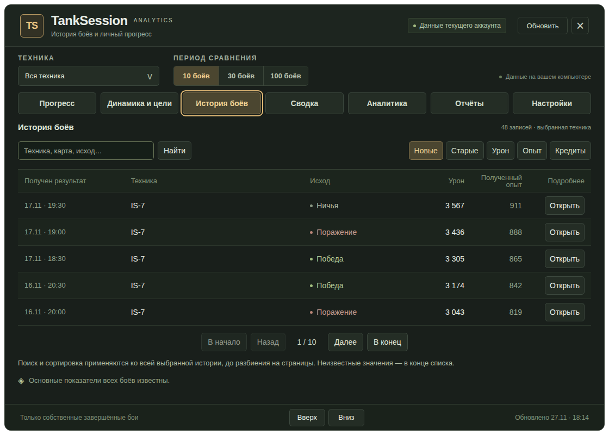

Карточки техники и горизонтальный счётчик страниц:

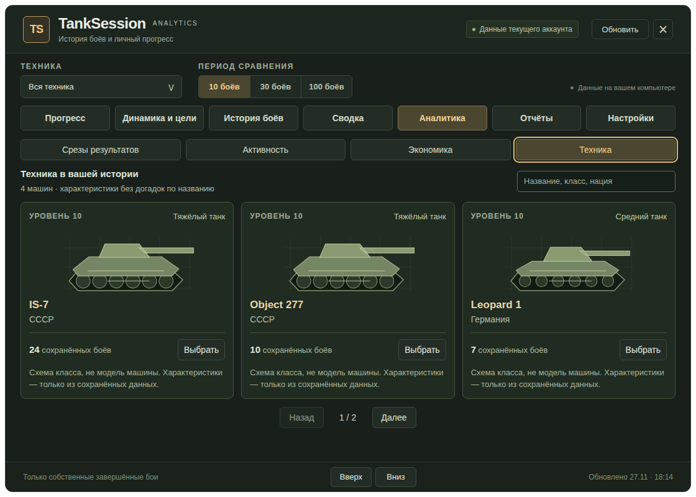

Верхняя часть отчёта: периоды расположены горизонтально, кнопки прокрутки подписаны словами «Вверх» и «Вниз»:

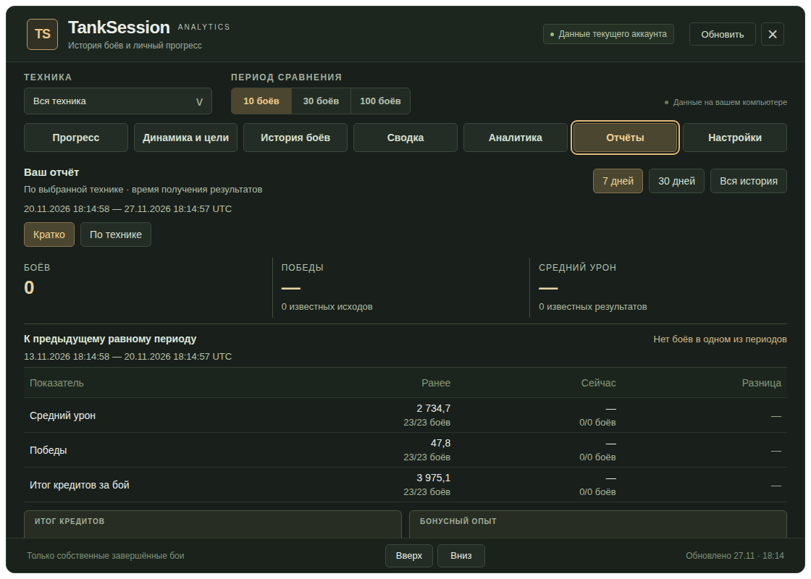

Нижняя часть длинного отчёта после прокрутки; footer остаётся доступным:

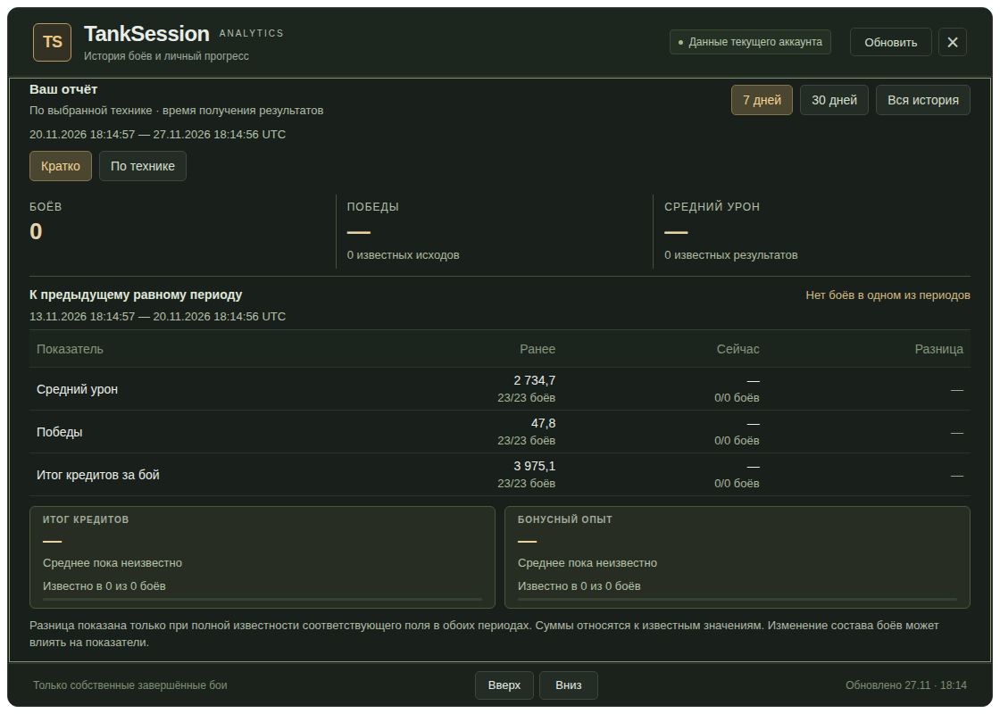

### Аналитика по картам и технике

Метрика и группировка выбираются явно; неполное покрытие остаётся видимым.

### Календарь и активность

Время соответствует получению результата модом, в UTC.

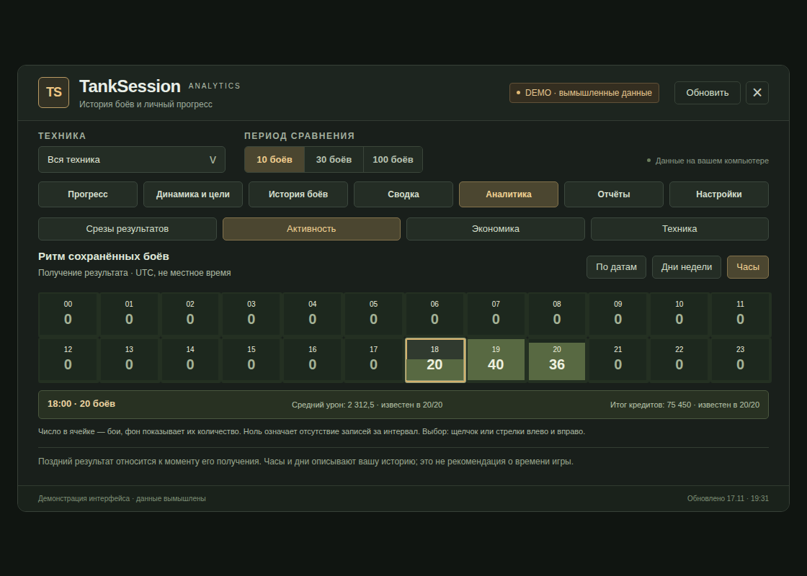

### Карточки техники

Изображения обозначают классы техники. Это оригинальные иллюстрации, а не изображения конкретных моделей танков.

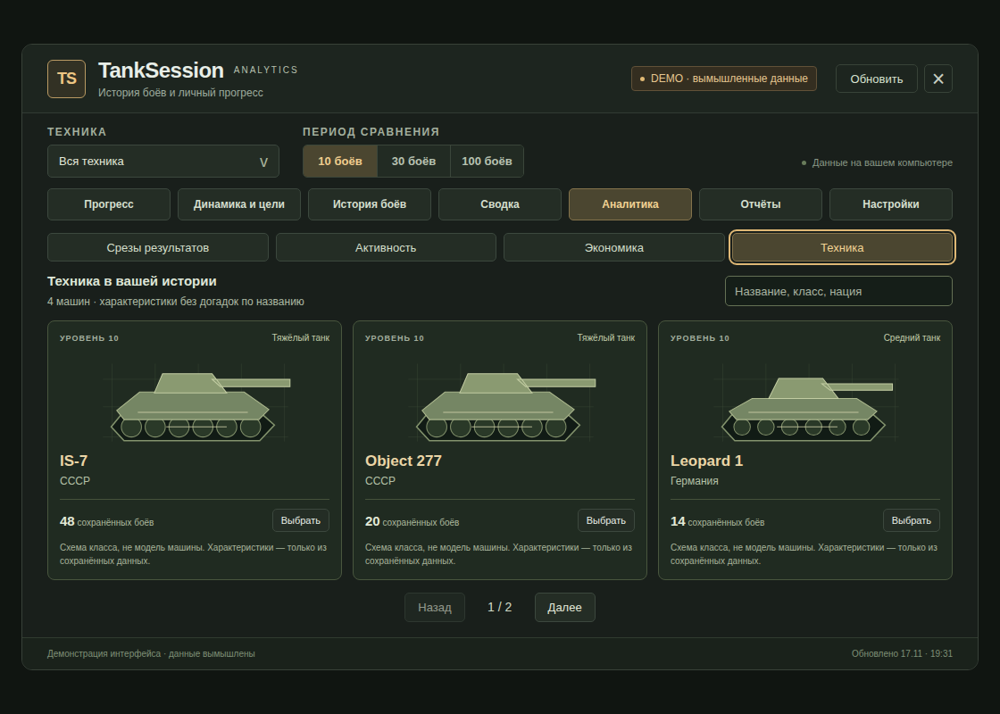

### Отчёт за период

Границы периода, соседняя выборка и полнота метрик показаны вместе с числами.

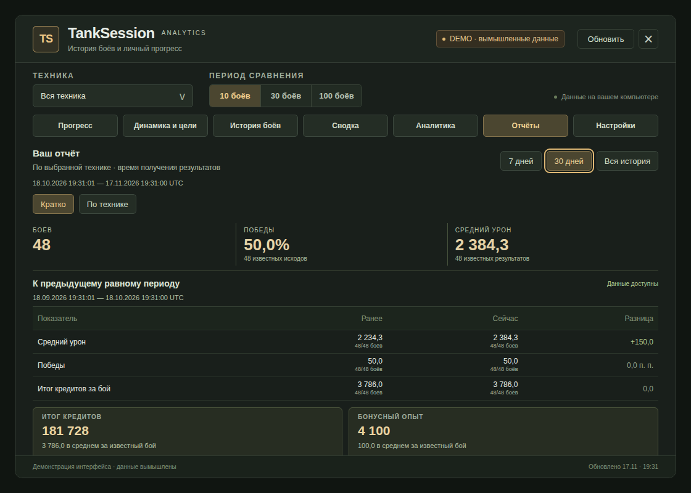

### Наблюдения Coach

Размер выборки и разброс сопровождают наблюдения. Предложение цели требует отдельного принятия.

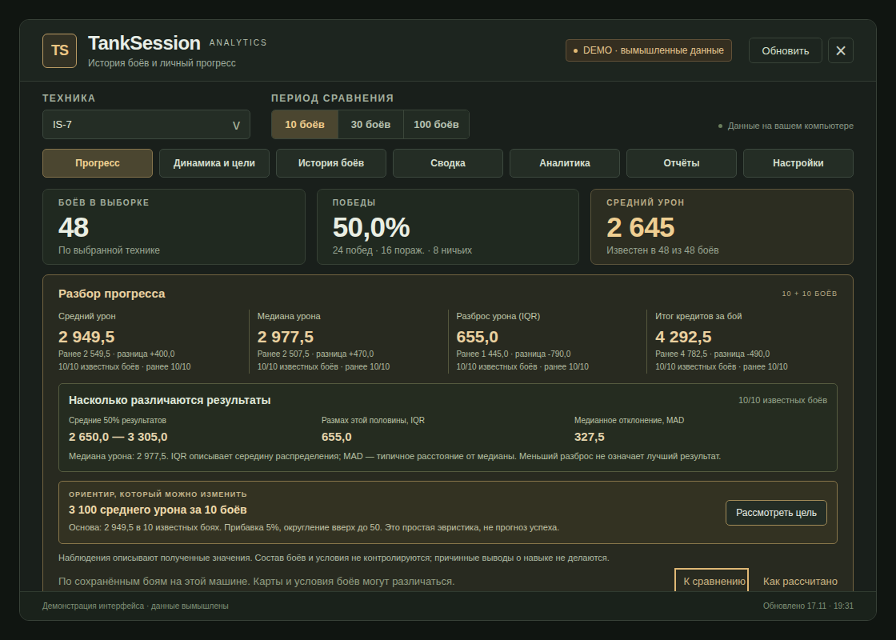

### Светлая тема и персональная панель

Тема, состав и порядок блоков сохраняются в личном профиле.

## Архив: 1.0.0-rc1

Снимки ниже получены из настоящего React-интерфейса в Chromium (1120 × 800) на вымышленных данных. Это браузерная проверка; они не подтверждают работу новой версии в нативном Gameface.

Источник: [CI 45863618520, коммит 6f657a4](https://github.com/xeemoff/tanksession-analytics/actions/runs/45863618520), задание React / TypeScript / browser preview: **14 сценариев прошли**. Windows-задание в этом первом запуске обнаружило ошибки установщика и CLI; их исправления и повторные проверки перечислены в [отчёте](READINESS_1_0_0_RU.md). PNG скопированы из артефакта без изменения содержимого.

### Полная история

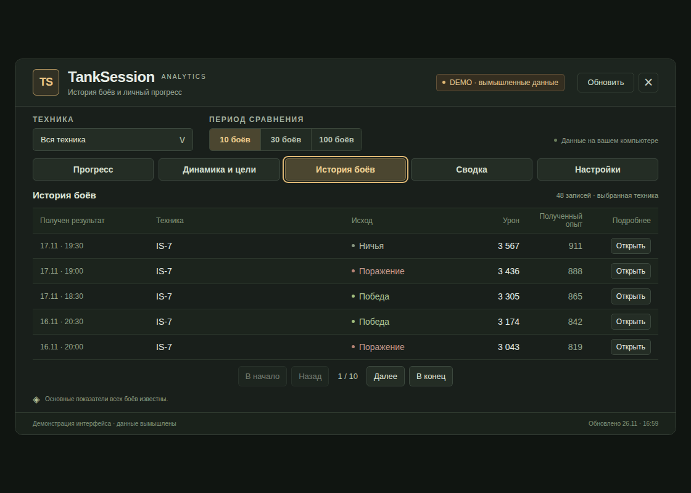

### Личные цели

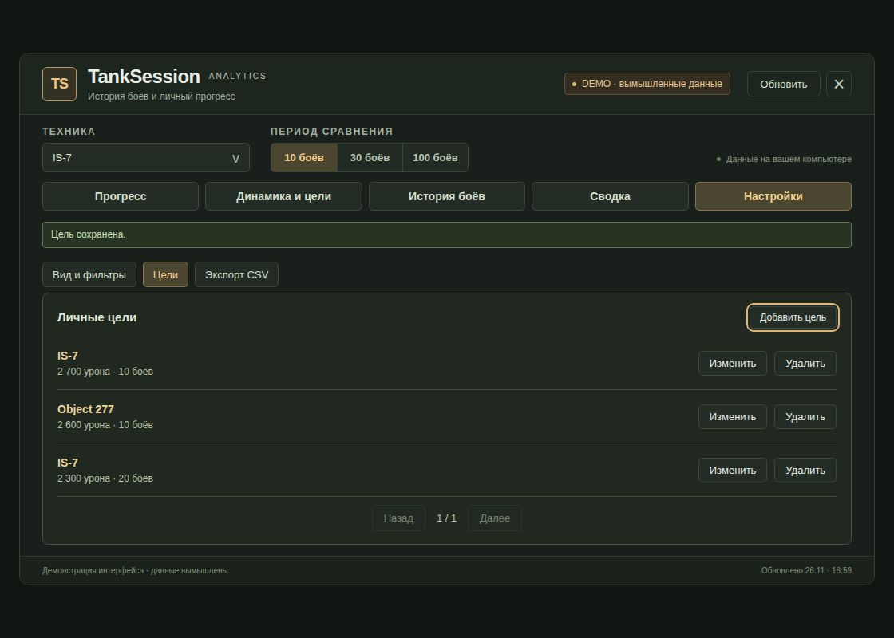

### Настройки вида

### Дополнительные показатели

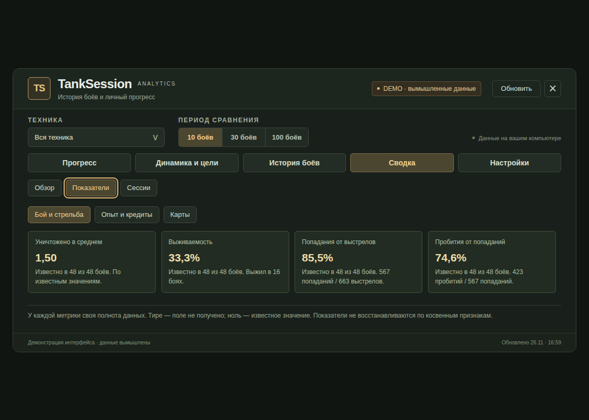

### Сессии

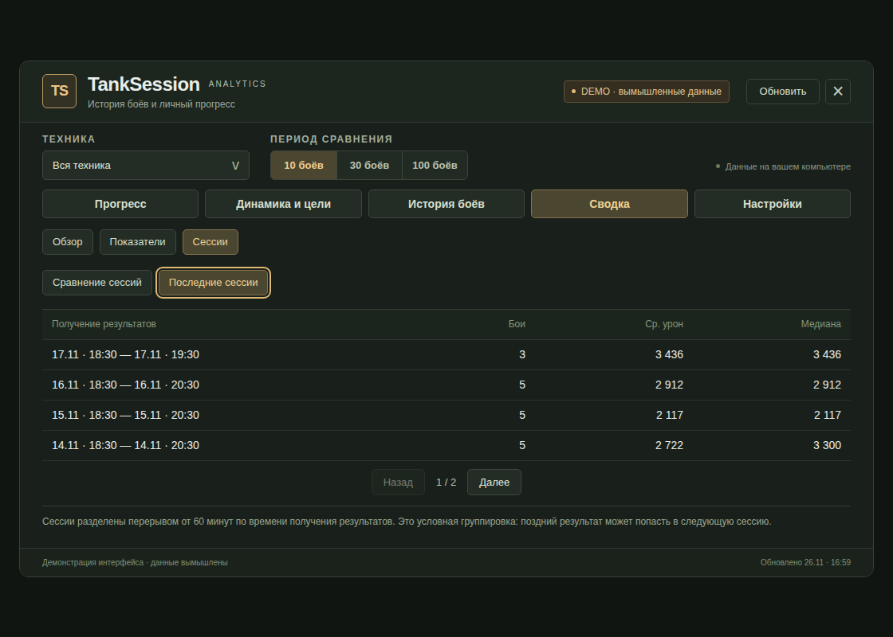

### Разбор прогресса

## Архив: 0.4.0-rc9

Снимки получены из **настоящего React-интерфейса** в Chromium (1120 × 800) на вымышленных данных. Оригинальная игровая история, логины, идентификаторы, скриншоты ангара и чужие игровые ресурсы не публикуются. Снимки подтверждают браузерный вид, а не совместимость rc9 с Gameface.

Источник: [браузерный тест rc9, CI 45853225132](https://github.com/xeemoff/tanksession-analytics/actions/runs/45853225132). Исходные снимки преобразованы в JPEG при захвате для компактного хранения в репозитории.

### Прогресс rc9

Специальный сценарий из 20 вымышленных боёв: среднее и медиана меняются в разных направлениях.

### Динамика и цели rc9

Урон отдельных сохранённых боёв и переключатель скользящего среднего. Столбец можно выбрать для получения подробностей.

### История боёв rc9

Постраничный список собственных результатов с исходом, уроном и опытом.

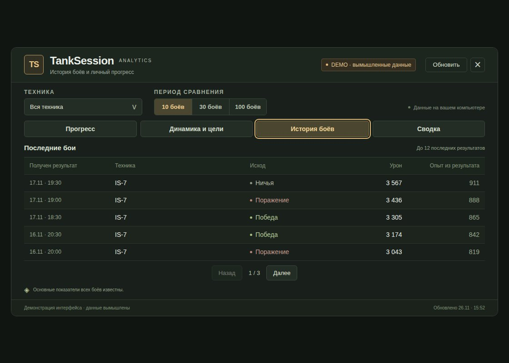

### Сводка rc9

Разбивка исходов, последняя серия сохранённых результатов, помощь и сводная таблица техники.

## Посмотреть самостоятельно

[Быстрый старт](../START_HERE_RU.md) · [Кандидат и Preview](../README.md#скачать-и-установить) · [Протокол фактической проверки в игре](CLIENT_VALIDATION_RU.md).
